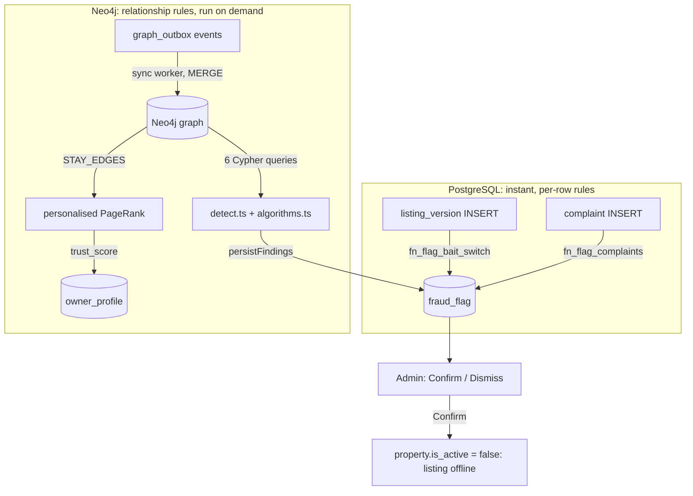

# Database logic and fraud flagging: how every trigger, procedure and function works

Source files: `db/01_listing.sql` and `db/02_workflow.sql` (SQL objects), `src/lib/graph/*` and `db/neo4j_model.cypher` (graph part). Every item below says **what fires it, what it does, what it rejects/produces, and an example**.

Contents: 1 Quick reference - 2 Integrity triggers - 3 Hash-chain and bitemporal functions - 4 Publishing function - 5 Fraud-flag triggers (SQL) - 6 Escrow procedures and ledger - 7 Outbox trigger - 8 Views - 9 Fraud flagging end to end (SQL + Neo4j) - 10 Neo4j detection rules - 11 Trust score - 12 Worked examples with the seed data - 13 Tuning and limits

---

## 1. Quick reference

| Name | Kind | Fires on / called by | One-line purpose |
|---|---|---|---|
| `fn_block_mutation` | trigger function | BEFORE UPDATE/DELETE on `listing_version`, `listing_photo`, `ledger_entry` | Makes those tables append-only |
| `fn_listing_hash` | function | used by the chain trigger and verifier | Canonical SHA-256 of a listing row |
| `fn_listing_chain` | trigger function | BEFORE INSERT on `listing_version` | Assigns seq, transaction time, prev_hash, row_hash |
| `fn_verify_listing_chain` | function | called by the app (listing page, evidence API) | Re-checks every hash in a property's history |
| `fn_listing_as_of` | function | called by the evidence API | Bitemporal lookup: what did the DB know at time T |
| `sp_publish_listing` | function (atomic) | called by owner publish API | Inserts a version and its photos in one transaction |
| `fn_flag_bait_switch` | trigger function | AFTER INSERT on `listing_version` | Raises a flag on price jump after tenant interest |
| `fn_flag_complaints` | trigger function | AFTER INSERT on `complaint` | Raises a flag at 3 distinct complainants in 30 days |
| `fn_review_guard` | trigger function | BEFORE INSERT on `review` | Only genuine long-term tenants may review |
| `fn_escrow_transition` | trigger function | BEFORE UPDATE OF status on `escrow` | Only legal state changes |
| `fn_ledger_balanced` | constraint trigger function | AFTER INSERT on `ledger_entry`, deferred to COMMIT | Debits must equal credits |
| `fn_outbox` | trigger function | AFTER INSERT on `listing_version`, `review`; INSERT/UPDATE of status on `lease` | Queues an event for Neo4j |
| `sp_hold_escrow` | procedure | `CALL` by tenant pay API | Take token money into escrow |
| `sp_checkin` | procedure | `CALL` by tenant/owner check-in API | Record presence, verify OTP, auto-release |
| `sp_release_escrow` | procedure | called by `sp_checkin` | Pay the owner minus fee |
| `sp_refund_escrow` | procedure | `CALL` by refund API | Return money to tenant |

Triggers run inside the transaction of the statement that fired them. If a trigger raises an exception, the whole statement and its transaction roll back, and the app returns the message as a 400 (`P0001` mapped in `src/lib/http.ts`).

---

## 2. Integrity triggers

### 2.1 `fn_block_mutation` - append-only tables
- **Fires:** `trg_lv_immutable` (listing_version), `trg_photo_immutable` (listing_photo), `trg_ledger_immutable` (ledger_entry), each BEFORE UPDATE OR DELETE, FOR EACH ROW.
- **Does:** always raises `UPDATE on listing_version is not allowed: table is append-only`.
- **Why:** history and money records must never be edited. A change is a new row, never an overwrite. Even a bug in the app cannot rewrite the past.
- **Try it:** `UPDATE listing_version SET monthly_rent = 1 WHERE version_id = 1;` -> error.

### 2.2 `fn_review_guard` - genuine reviewers only
- **Fires:** BEFORE INSERT on `review`.
- **Does:** loads the lease; rejects if the lease status is not ACTIVE/ENDED **or** the lease started less than 30 days ago.
- **Message:** `review not allowed: lease N has not run for 30 days`.
- **Extra protection by schema:** `UNIQUE(lease_id)` (one review per lease) and FK `(lease_id, tenant_id)` (only the lease's tenant can review).
- **Why:** stops drive-by fake reviews and "review before you move in".

### 2.3 `fn_escrow_transition` - escrow state machine
- **Fires:** BEFORE UPDATE OF status on `escrow`.
- **Allowed:** HELD -> RELEASED | REFUNDED | DISPUTED, and DISPUTED -> RELEASED | REFUNDED. Anything else (e.g. RELEASED -> HELD, REFUNDED -> RELEASED) raises `illegal escrow transition X -> Y`.
- **Why:** money cannot be released twice or revived after refund, whatever the application does.

### 2.4 `fn_ledger_balanced` - double-entry check (constraint trigger)
- **Fires:** `trg_ledger_balanced`, AFTER INSERT on `ledger_entry`, `DEFERRABLE INITIALLY DEFERRED`, so it runs **at COMMIT**.
- **Does:** for the row's `txn_group`, sums amounts where direction = 'D' and 'C'; if they differ raises `unbalanced ledger transaction`.
- **Why deferred:** the rows of one posting are inserted one by one; the group is only balanced after the last row. Checking per row would fail on the first insert.
- **Effect:** an unbalanced posting aborts the whole transaction, so escrow status and ledger can never disagree.

---

## 3. Hash-chain and bitemporal functions

### 3.1 `fn_listing_hash(r listing_version) -> text`
Returns `SHA-256` (hex) of this string, joined with `|`: previous hash (or `GENESIS`), property id, seq, title, rent, deposit, address, locality, city, pincode, contact phone, amenities, effective_from, recorded_at (UTC, microseconds), recorded_by, photo_digest. It is used in exactly two places - the trigger that writes the hash and the verifier that rechecks it - so they cannot drift apart.

### 3.2 `fn_listing_chain()` - the chain trigger
- **Fires:** BEFORE INSERT on `listing_version` (so it can modify the new row).
- **Steps:**
  1. `SELECT ... FROM property WHERE property_id = NEW.property_id FOR UPDATE` - locks the parent so two simultaneous edits of the same property are serialised and cannot both claim the same `seq`.
  2. Reads the latest row's `row_hash` and `seq`.
  3. Sets `NEW.seq = last + 1`, `NEW.prev_hash = last hash`, `NEW.recorded_at = clock_timestamp()`, `NEW.row_hash = fn_listing_hash(NEW)`.
- **Why `clock_timestamp()`:** the owner cannot back-date a record (the client's value is overwritten), and unlike `now()` it is not frozen at transaction start.
- **Result:** every property has a chain v1 <- v2 <- v3, each hash covering the one before.

### 3.3 `fn_verify_listing_chain(p_property) -> (version_seq, intact)`
For each version: `intact = (row_hash == recomputed hash) AND (prev_hash == previous row's row_hash)` (the previous row is found with `LAG` over `seq`). The app shows "Hash chain verified" when all rows are true, otherwise "Tamper detected". Altering any old field changes its recomputed hash and breaks that row and the link to the next.

### 3.4 `fn_listing_as_of(p_property, p_known_at, p_valid_on) -> listing_version`
Returns the single latest row with `recorded_at <= p_known_at` and `effective_from <= p_valid_on`, ordered by `effective_from DESC, seq DESC`.
- **valid time** (`effective_from`) = when the terms apply; **transaction time** (`recorded_at`) = when the database learned it.
- **Use:** dispute evidence. Called with the enquiry time: "what did the database know when the tenant enquired?" The tenant dashboard shows three columns: *You saw* (pinned `seen_version_id`), *As known then* (this function), *Now*.

---

## 4. `sp_publish_listing(...) -> version_id`
Called by `POST /api/owner/listings` inside the app's transaction.
1. Checks the caller owns the property, else `user N does not own property M`.
2. Checks the photo URL array and hash array have equal length.
3. Computes `photo_digest` = SHA-256 of the sorted photo hashes (so a photo change changes the row hash).
4. Inserts the `listing_version` row (the chain trigger fills seq/hash/time and the bait-and-switch trigger may fire).
5. Inserts one `listing_photo` row per photo with its position.
6. Returns the new version id.
Because it is one function call, either the version and all its photos exist or none do.

---

## 5. Fraud-flag triggers (SQL side)

### 5.1 `fn_flag_bait_switch` - bait and switch
- **Fires:** AFTER INSERT on `listing_version` (the row is already in the chain).
- **Skips** the first version of a property.
- **Condition:** rent > previous rent x 1.15 **OR** deposit > previous deposit x 1.50, **AND** at least one enquiry for the property was created within 14 days before this version was recorded.
- **Action:** inserts `fraud_flag(owner, property, 'BAIT_AND_SWITCH', severity 4, source 'SQL_TRIGGER', evidence {old_rent,new_rent,old_deposit,new_deposit,version_seq})`.
- **Does not block** the publish: the owner may legitimately raise rent. The point is to make it visible and provable. The owner sees "Published, but the database flagged this change" at once.
- **Example:** property 14 goes 6,500 -> 9,000 (+38%) after a tenant enquiry -> flag, severity 4.
- **Quiet cases:** +10% rent (below threshold); +40% rent with no enquiry in 14 days (nobody was baited).

### 5.2 `fn_flag_complaints` - complaint cluster
- **Fires:** AFTER INSERT on `complaint`.
- **Does:** finds the property's owner, counts **distinct complainants** across all that owner's properties in the last 30 days. If >= 3 and no OPEN `HIGH_COMPLAINTS` flag exists, inserts one (severity 3, evidence `{distinct_complainants_30d: n}`).
- **Distinct** matters: one angry tenant filing five complaints counts once.
- **No duplicates:** the open-flag check prevents a new flag per complaint.

---

## 6. Escrow procedures and the ledger

Procedures are called with `CALL` inside the app's `tx()` (BEGIN ... COMMIT), so a failure rolls everything back. The ledger posts balanced rows with one shared `txn_group` UUID.

| Procedure | Preconditions | Effects | Ledger rows |
|---|---|---|---|
| `sp_hold_escrow(inquiry, amount, otp, key)` | inquiry exists; amount <= the monthly rent the tenant saw | inserts escrow HELD with `crypt(otp, gen_salt('bf'))`, 72 h window, idempotency key; a repeated key does nothing (`ON CONFLICT DO NOTHING`) | ESCROW **D** x, TENANT **C** x |
| `sp_checkin(escrow, user, otp)` | escrow HELD, not past `otp_expires_at`; user is the tenant or the owner | tenant: sets `tenant_checkin_at`. owner: verifies `crypt(otp, otp_hash) = otp_hash` else `invalid OTP`, then sets `owner_checkin_at`. If both set -> `CALL sp_release_escrow` | (via release) |
| `sp_release_escrow(escrow)` | row locked `FOR UPDATE` | status RELEASED, `resolved_at`; fee = 2% rounded | ESCROW **C** x, OWNER **D** x-fee, PLATFORM **D** fee |
| `sp_refund_escrow(escrow)` | row locked `FOR UPDATE` | status REFUNDED, `resolved_at` | ESCROW **C** x, TENANT **D** x |

Extra safeguards on the table itself:
- `CHECK (status <> 'RELEASED' OR (tenant_checkin_at IS NOT NULL AND owner_checkin_at IS NOT NULL))` - release is impossible without both check-ins, even by direct SQL.
- `idempotency_key UNIQUE` - a retried payment cannot charge twice.
- `fn_escrow_transition` and `fn_ledger_balanced` (section 2) back up the procedures.
- The OTP is generated by the API, shown once to the tenant, and stored only as a bcrypt hash.

Timeline of a happy path: hold (HELD) -> tenant check-in -> owner enters OTP -> `sp_checkin` sees both -> `sp_release_escrow` -> RELEASED -> owner can create a lease at the rent the tenant saw.

---

## 7. `fn_outbox` - queueing events for Neo4j
- **Fires:** AFTER INSERT on `listing_version` and `review`; AFTER INSERT OR UPDATE OF status on `lease`.
- **Does:** `INSERT INTO graph_outbox (event_type, payload) VALUES (TG_TABLE_NAME || '.' || TG_OP, to_jsonb(NEW))`, e.g. `listing_version.INSERT`.
- **Why a trigger in the same transaction:** the event exists if and only if the change committed. No change can be lost or announced falsely.
- A separate worker applies the events to Neo4j (section 9).

---

## 8. Views
- `v_current_listing`: per active property the newest version whose `effective_from <= today` (`DISTINCT ON`). Public search reads this view, so tenants only ever see the live terms.
- `v_owner_risk`: per owner: trust score and time, count of non-dismissed flags, complaints, average rating. Feeds the admin "Owner risk" tab.
- `v_escrow_summary`: escrow rows with the balance computed from the ledger (should be 0 once resolved).

---

## 9. Fraud flagging end to end (SQL triggers + Neo4j graph)

Two detectors feed **one review queue** (`fraud_flag`):



**Why both:** a trigger sees one row at a time and reacts instantly (a price jump, a pile of complaints). Collusion needs connecting many rows across many owners (shared phones, photos, addresses), which is a graph question that SQL answers badly.

**Pipeline, step by step**
1. Owners publish, leases become active, tenants review. Triggers write events to `graph_outbox`.
2. **Sync** (button 1 in admin, or `npm run graph:sync`): for each unprocessed event (`FOR UPDATE SKIP LOCKED`) run idempotent `MERGE` Cypher, then mark it processed. Account phones are re-upserted each run.
3. **Detect** (button 2): runs six read queries, derives findings, clusters owners, and writes flags.
4. **Trust** (button 3): computes personalised PageRank and writes `owner_profile.trust_score`.
5. **Admin reviews** each OPEN flag: *Confirm* (listing taken offline) or *Dismiss* (false positive; the same finding will not be re-raised).
6. Tenants see "under review" badges on listings whose owner has an OPEN flag of severity 3 or higher.

**What the graph contains** (built from outbox events)
```
(Owner)-[:OWNS]->(Property)-[:LISTED_WITH_PHONE]->(Phone)
                        |-[:LOCATED_AT]->(Address)   key = pincode|locality|street, normalised
                        |-[:USES_PHOTO]->(Photo)      key = SHA-256 of image bytes
(Owner|Tenant)-[:HAS_PHONE]->(Phone)                  registration phone
(Tenant)-[:VERIFIED_STAY {months, weight}]->(Owner)    from ACTIVE/ENDED leases
(Tenant)-[:REVIEWED {rating}]->(Owner)
```
Normalising addresses (drop dots/apostrophes, lowercase, collapse punctuation) means "M.G. Road" and "MG Road" become one node, so typing it differently does not hide a link.

---

## 10. Neo4j detection rules

All traversals are in `src/lib/graph/cypher.ts`; conversion to flags is in `algorithms.ts` (`deriveFindings`).

| # | Query | Pattern it finds | Flag raised | Severity |
|---|---|---|---|---|
| 1 | `SHARED_IDENTITY_PAIRS` | `Owner1 -> Property -> X <- Property <- Owner2` where X is the same Phone, Photo or Address node (same relationship type both sides, owner ids different) | feeds clustering (below) | - |
| 2 | `SHARED_ACCOUNT_PHONE` | two different owner accounts with the same registration phone | feeds clustering | - |
| 3 | `SELF_PHOTO_REUSE` | one owner uses the same photo on two properties at different addresses | `DUPLICATE_PHOTO` (same owner) | 2 |
| 4 | `PHONE_SPREAD` | one phone number on 3+ listings across 2+ addresses | `SHARED_CONTACT` | 3 |
| 5 | `REVIEW_COLLUSION` | a tenant who stayed with / reviewed an owner while sharing that owner's account phone | `REVIEW_RING` | 4 |
| 6 | `REVIEW_FARM` | owner with 3+ reviewers where 80%+ review nobody else | `REVIEW_RING` | 3 |

### Clustering (rules 1 and 2)
Each shared item adds weight to the pair of owners: **phone 3, account phone 3, photo 3, address 1.** A pair is linked when its total weight >= 3. So one shared phone or photo links two owners; a shared address alone (flatmates, family, co-owners of a PG building) does not. Linked pairs are merged with union-find, so A-B and B-C make one ring {A, B, C}.

Findings from clusters:
- Cluster whose evidence includes a phone: every owner involved in a shared phone gets `SHARED_CONTACT`, severity **5** if the ring has 3+ owners, **4** if 2.
- Every shared photo: the owner whose listing appeared **later** (by `listedAt`, ties by property id) is the suspected copier and gets `DUPLICATE_PHOTO`, severity **3**. The original owner is not flagged. Evidence names who they copied from, the photo hash prefix and both property ids.

### Flag writing rules (`persistFindings`)
One live flag per owner, flag type and source GRAPH:
- no earlier flag -> insert new (OPEN);
- existing OPEN -> refresh severity and evidence (no duplicates on repeated runs);
- existing CONFIRMED -> left unchanged;
- existing DISMISSED -> **suppressed**: the admin already judged it a false positive, so it is not raised again.
Evidence is stored as JSON and shown in the admin queue, including the cluster of owner ids and the shared phone numbers.

### What an admin does
Open the flag, read the evidence, then **Confirm** (the property is set `is_active = false`, vanishing from public search, and the owner is notified on their dashboard) or **Dismiss**. Both record `reviewed_by`, required by a table CHECK.

---

## 11. Trust score (sybil-resistant)
- **Threat:** an owner creates fake tenants and fake leases to look trustworthy.
- **Graph:** tenants and owners as nodes, `VERIFIED_STAY` as undirected weighted edges (weight = months stayed, capped at 12, minimum 1).
- **Algorithm:** PageRank with damping 0.85 where the random surfer **teleports only to ID-verified tenants** (`tenant_profile.id_verified`, set by an admin). Probability mass can only enter the graph at verified tenants.
- **Effect:** an owner reachable only through unverified or fake accounts receives no mass and scores 0. Owners with long stays from many verified tenants score highest. Scores are divided by the maximum, so the best owner is 1.0.
- **Stored in** `owner_profile.trust_score` with `trust_updated_at`; listings show the score, or "not scored yet" before the first run.
- Toggling a tenant's verification (Admin > Users) changes the seeds; recompute to see scores move.

---

## 12. Worked examples with the seed data

| Scenario in `seed.sql` | What the system does |
|---|---|
| Owners **Vikram (6)** and **Anil (7)** register with the same phone 9845099999 and share listing photos | Rules 1 and 2 link them (weight >= 3, several times over). One cluster {6, 7}; both get `SHARED_CONTACT` severity 4. Shared photos produce `DUPLICATE_PHOTO` against the later lister. |
| Guest reviewer A (tenant 22) has the same phone 9845099999, unverified, short stays | `REVIEW_COLLUSION` fires for the shared account phone -> `REVIEW_RING` on the owners involved. As an unverified tenant, they also give the owners no trust mass. |
| **Kiran (9)** lists with a photo first used by **Lakshmi (3)** | Photo node shared across two owners; Kiran's listing is later, so **Kiran** gets `DUPLICATE_PHOTO` (3). Lakshmi is not flagged. |
| Property 14: rent 6,500 -> 9,000 after an enquiry | SQL trigger raises `BAIT_AND_SWITCH` (4) at insert time, independent of Neo4j. |
| Verified tenants with leases at Ramesh, Lakshmi, Suresh, Meena | They seed PageRank; these owners get the top trust scores. |

---

## 13. Tuning, limits and honesty notes
- **Thresholds are plain numbers** you can change: 15% / 50% / 14 days in `fn_flag_bait_switch`; 3 complainants / 30 days in `fn_flag_complaints`; weights and threshold in `algorithms.ts` (`LINK_WEIGHT`, `LINK_THRESHOLD`); 80% and 3 reviewers in `REVIEW_FARM`; PageRank damping in `personalizedPageRank`.
- **False positives are expected:** flags are signals for human review, never automatic bans. A flag does not remove a listing; only the admin's *Confirm* does.
- **Detection is on demand,** not continuous; run sync + detect after changes (or schedule `graph-sync --watch` and a periodic detect call).
- **Exact photo hash only:** a re-compressed or cropped copy gets a different SHA-256 and slips through (future work: perceptual hash or pgvector embeddings).
- **Neo4j was not available in the build environment.** The clustering, findings and PageRank are unit-tested against a Postgres-backed emulator, and the Cypher text is parser-checked but has not been executed on a live server. Verify once on your machine: sync, detect, and confirm the {Vikram, Anil} cluster and the Kiran photo flag appear.
