**Course:** Database Management Systems, Experiential Learning Level 3  
**Instructor:** Dr. Nagasundari S  
**Team:** [Member A: name, SRN] and [Member B: name, SRN]  
**Stack:** Next.js 15 (App Router), PostgreSQL 16, Neo4j 5  
**Repository:** [GitHub URL]

# 1. Problem statement

Online rental platforms for apartments and paying-guest (PG) rooms suffer from four recurring frauds: listings whose price quietly changes after a tenant shows interest (bait-and-switch), the same property re-posted under many identities, token money paid to owners who then disappear, and fake reviews that inflate reputation. An ordinary create-read-update-delete application cannot prove what a listing said at a given moment, cannot hold money safely between strangers, and cannot see relationships that span many owners.

RentGuard is a rental aggregator in which these behaviours are made technically hard or visible, using a hybrid database design: PostgreSQL as the transactional system of record and Neo4j as a relationship graph used for fraud-ring detection and trust scoring.

# 2. Objectives

1. Keep an immutable, verifiable history of every listing edit and answer "what exactly did the tenant see when they enquired?" (tamper-evident, bitemporal history).
2. Hold token money in escrow and release it only when the tenant and the owner both confirm a visit with a one-time code (ACID transactions, double-entry ledger).
3. Detect owner rings that share phones, photos or addresses across supposedly different listings, and score owner trust in a way fake accounts cannot inflate (graph traversal and personalised PageRank).
4. Enforce integrity inside the database (constraints, triggers, procedures) so that rules hold for every client, not only for our application.
5. Provide three role-based interfaces (tenant, owner, administrator) over a secure API.

# 3. Scope

**In scope:** user registration and login, listing publishing with photos and versions, full-text search, enquiries, escrowed token payment with OTP check-in and refund, leases, reviews, complaints, automatic and graph-based fraud flags, an administrator review queue, trust scores, SQL analytics.
**Out of scope:** a real payment gateway, SMS/e-mail delivery, geolocation-checked visits, perceptual image matching, and scheduled background jobs.

# 4. Functional requirements

| Role | Functions |
|----------|----------------------------------------------------|
| Visitor | Search listings (full-text, locality, type, rent range, amenity, sort by rent or trust); view listing, price history, hash-chain status, reviews; register; log in |
| Tenant | Enquire about a specific version of a listing; pay a refundable token into escrow and receive a one-time visit code; check in; claim a refund after the visit window; dispute; view bitemporal evidence of price changes; review a property after 30 days of a lease; file complaints |
| Owner | Add properties; publish new listing versions with up to six photos; confirm the tenant's visit with the code; create a lease at the rent the tenant saw; see fraud flags raised on the account |
| Administrator | Review fraud flags (confirm: listing taken offline, or dismiss); run graph sync, ring detection and trust computation; manage complaints; verify tenants (seeds of trust); view the owner-risk view and SQL insight queries |

**Non-functional:** passwords stored only as bcrypt hashes; all secrets in environment variables; database-level validation; responsive interface; every state change transactional.

# 5. System architecture

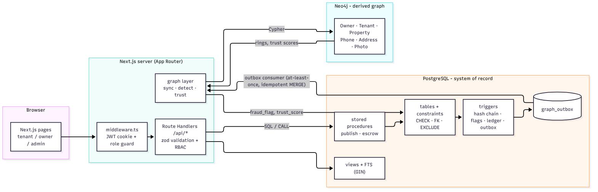{width=6.5in}

The browser talks to Next.js. Middleware checks the session cookie and role for pages, and every API route is wrapped by a function that verifies the JWT, checks the role, validates input with zod and converts database errors into safe messages. Route handlers call PostgreSQL through a connection pool and run multi-step operations in transactions that `CALL` stored procedures. PostgreSQL is the single source of truth. Triggers write change events to an outbox table in the same transaction; a sync worker applies them to Neo4j with idempotent `MERGE` statements. Detection results (fraud flags and trust scores) are written back to PostgreSQL, so the application reads from one place and keeps working if Neo4j is unavailable.

# 6. Database design

## 6.1 ER diagram

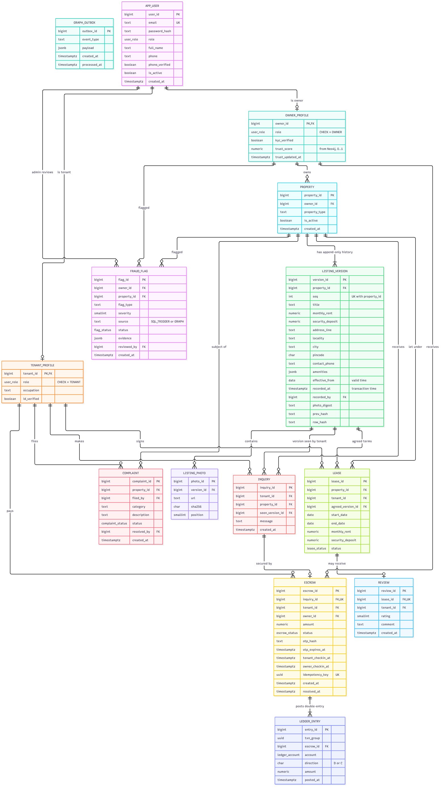{width=6.5in}

## 6.2 Relational schema (14 tables)

| Table | Purpose | Key integrity rules |
|-------------|------------------|----------------------------------|
| app_user | all accounts, role enum | unique e-mail, e-mail and phone regex checks, bcrypt hash, `UNIQUE(user_id, role)` as foreign-key target |
| owner_profile, tenant_profile | role-specific data | role column pinned by CHECK and composite FK, so an owner profile can only reference an OWNER user |
| property | stable identity of one rentable unit | type check, `is_active` flag for admin takedown |
| listing_version | append-only history of every listing edit | rent > 0, deposit >= 0, pincode and phone patterns, unique (property, seq), hash-chain columns |
| listing_photo | photos of a version with SHA-256 | hash pattern check, unique (version, hash), append-only |
| inquiry | tenant interest pinned to the version seen | composite FK (version, property) |
| lease | tenancy | end after start, **EXCLUDE** constraint forbids overlapping live leases per property |
| escrow | token money state machine | amount >= 100, release requires both check-ins, unique idempotency key, bcrypt OTP hash |
| ledger_entry | double-entry postings | direction D or C, amount > 0, append-only |
| review | one per lease | unique lease, composite FK ties it to the lease's tenant |
| complaint | tenant reports | category and length checks |
| fraud_flag | review queue (source SQL trigger or graph) | type and severity checks, evidence JSONB, reviewed flags need a reviewer |
| graph_outbox | events for Neo4j | partial index on unprocessed rows |

The complete column-level data dictionary with every constraint, index and trigger is in Appendix A.

## 6.3 Normalisation

All tables are in third normal form: user data is stored once in `app_user`; role-specific attributes live in profile tables; listing terms live in `listing_version`; there are no repeating groups and no transitive dependencies. Two denormalised values are deliberate: `owner_profile.trust_score` (a computed result written back from the graph) and the hash columns of `listing_version`. Separating `property` (identity) from `listing_version` (terms over time) is what makes history possible without in-place updates. Amenities are a JSONB array because they are free-form tags searched only by membership.

## 6.4 Why two databases (choice justification)

| Data and workload | Store | Reason |
|--------------------|-------|-------------------------------------|
| Accounts, listings and their history, inquiries, escrow, ledger, leases, reviews, complaints, flags | PostgreSQL | Needs ACID transactions, foreign keys, CHECK and EXCLUDE constraints, triggers and stored procedures. Money and evidence must be strictly consistent. |
| Relationships between owners, phone numbers, addresses, photos and tenants | Neo4j | "Which owners are connected through any chain of shared phones, photos or addresses?" has variable depth. In SQL it requires repeated self-joins that grow worse with every hop; in Cypher it is a single pattern. PageRank is also naturally a graph computation. |

Neo4j holds only a derived copy. If it is lost it can be rebuilt from PostgreSQL by replaying the outbox, which is why money and history never live there.

# 7. Implementation

## 7.1 Advanced database features

| # | Feature | Implementation |
|--|----------------|--------------------------------------------|
| 1 | Transactions and stored procedures | `sp_hold_escrow`, `sp_checkin`, `sp_release_escrow`, `sp_refund_escrow`, `sp_publish_listing`, always called inside one `BEGIN ... COMMIT` |
| 2 | Triggers (eight trigger functions, twelve triggers) | hash chain, append-only (listing, photo, ledger), bait-and-switch flag, complaint threshold flag, review guard, escrow state machine, deferred ledger balance check, outbox events |
| 3 | Views | `v_current_listing`, `v_owner_risk`, `v_escrow_summary` |
| 4 | Full-text search | GIN index on `to_tsvector('english', title \|\| locality \|\| address)` with `websearch_to_tsquery` and `ts_rank` |
| 5 | Indexing | GIN (text, JSONB), B-tree composites, partial indexes for held escrows, open flags and unprocessed outbox rows, GiST for lease overlap |
| 6 | Exclusion constraint | no two PENDING/ACTIVE leases may overlap on one property |
| 7 | Bitemporal data | `effective_from` (valid time) and `recorded_at` (transaction time); function `fn_listing_as_of` |
| 8 | Window functions and subqueries | analytics queries in section 8 |
| 9 | Graph traversal | six Cypher detection queries |
| 10 | Graph algorithm | personalised PageRank for trust |

## 7.2 Tamper-evident bitemporal listing history

Each edit of a listing is a new row; a trigger rejects any update or delete. A BEFORE INSERT trigger locks the property row, reads the previous row, assigns the version number, stamps the transaction time with `clock_timestamp()` (so an owner cannot back-date a record) and computes a SHA-256 hash over the previous hash and all business fields. The result is a hash chain: changing any old value changes its hash and breaks the link to the next row. `fn_verify_listing_chain` recomputes the chain and the user interface shows "Hash chain verified" or "Tamper detected".

An enquiry stores the exact version the tenant saw. `fn_listing_as_of` answers "what did the database know at the moment of the enquiry?", so the dispute screen compares three columns: what the tenant saw, what was known then, and what is true now. A trigger flags a bait-and-switch when rent rises more than 15 percent or the deposit more than 50 percent within 14 days of an enquiry. Leases copy the terms the tenant saw (price lock).

## 7.3 Escrow with one-time code

State machine: HELD, then RELEASED, REFUNDED or DISPUTED (a trigger forbids any other transition). The tenant pays a token (at least 100, at most one month's rent); the server generates a six-digit code, stores only its bcrypt hash and shows it once. At the property the tenant confirms presence and the owner types the code; when both have checked in `sp_checkin` releases the money, paying the owner minus a 2 percent platform fee. Every movement posts balanced rows to a double-entry ledger; a **deferred constraint trigger** checks debits equal credits at COMMIT, so an unbalanced posting aborts the whole transaction. Payments use an idempotency key so a retried request cannot charge twice.

## 7.4 Graph-based fraud flagging (Neo4j)

Graph model: owners, tenants, properties, phones, normalised addresses and photo hashes, linked by OWNS, LISTED_WITH_PHONE, LOCATED_AT, USES_PHOTO, HAS_PHONE, VERIFIED_STAY and REVIEWED.

1. **Sync.** The outbox consumer reads unprocessed events with `FOR UPDATE SKIP LOCKED` and applies idempotent `MERGE` statements (at-least-once delivery, safe replays).
2. **Detect.** Six Cypher queries find: owners sharing a phone, photo or address; owner accounts sharing a registration phone; one owner reusing a photo at different addresses; one phone on three or more listings at two or more addresses; tenants sharing an account phone with the owner they reviewed; and owners whose reviewers rarely review anyone else.
3. **Cluster.** Shared items carry weights (phone 3, account phone 3, photo 3, address 1); two owners are linked at total weight 3 or more, so a shared address alone does not link them. Union-find merges linked pairs into rings. For a shared photo the owner whose listing appeared later is flagged as the likely copier.
4. **Persist.** Findings are written to `fraud_flag` with source GRAPH, one live flag per owner and type: open flags are refreshed, dismissed ones are not raised again.
5. **Trust.** Personalised PageRank (damping 0.85) over verified-stay edges, where the random walk restarts **only at ID-verified tenants**. Accounts with no path from a verified tenant receive zero trust, which defeats fake-account (sybil) attacks. Scores are written to `owner_profile.trust_score`.
6. **Review.** The administrator confirms a flag (the listing is taken offline) or dismisses it.

## 7.5 Application security

| Concern | Control |
|----------|--------------------------------------------|
| Passwords | bcrypt; a dummy hash is compared for unknown e-mails so timing does not reveal which e-mails exist |
| Sessions | HS256 JWT in an httpOnly, SameSite cookie, 8-hour expiry, secret taken from the environment |
| Authorisation | role check in middleware (pages) and in every API route; ownership checks per record |
| Validation | zod in the API and CHECK / FK / EXCLUDE / triggers in the database |
| Injection | parameterised queries only; LIKE input escaped |
| Brute force | rate limiting on login and sign-up |
| Uploads | allow-listed image types, 3 MB limit, magic-byte check, content-addressed file names |
| Secrets | only in `.env` (ignored by git); `.env.example` holds placeholders |

# 8. Important queries

The administrator's "SQL insights" tab runs and displays these queries live.

**Average rent by locality (GROUP BY + aggregates on a view)**
```sql
SELECT locality, city, count(*)::int AS listings,
       round(avg(monthly_rent))::int AS avg_rent, min(monthly_rent) AS min_rent, max(monthly_rent) AS max_rent
  FROM v_current_listing
 GROUP BY locality, city
 ORDER BY avg_rent DESC
```

**Listings priced above their locality average (correlated subquery)**
```sql
SELECT c.property_id, c.title, c.locality, c.monthly_rent,
       (SELECT round(avg(x.monthly_rent))::int FROM v_current_listing x WHERE x.locality = c.locality) AS locality_avg
  FROM v_current_listing c
 WHERE c.monthly_rent > (SELECT avg(x.monthly_rent) FROM v_current_listing x WHERE x.locality = c.locality)
 ORDER BY c.monthly_rent DESC
```

**Owners with open flags or complaints (multi-table JOIN + HAVING)**
```sql
SELECT u.full_name AS owner,
       count(DISTINCT f.flag_id)::int AS open_flags,
       count(DISTINCT c.complaint_id)::int AS complaints
  FROM owner_profile o
  JOIN app_user u ON u.user_id = o.owner_id
  LEFT JOIN fraud_flag f ON f.owner_id = o.owner_id AND f.status = 'OPEN'
  LEFT JOIN property p ON p.owner_id = o.owner_id
  LEFT JOIN complaint c ON c.property_id = p.property_id
 GROUP BY u.full_name
HAVING count(DISTINCT f.flag_id) + count(DISTINCT c.complaint_id) > 0
 ORDER BY open_flags DESC, complaints DESC
```

**Every rent change with the previous value (window function LAG)**
```sql
SELECT property_id, seq, prev_rent, monthly_rent AS new_rent,
       round((monthly_rent - prev_rent) / prev_rent * 100, 1) AS pct_change, recorded_at
  FROM (SELECT property_id, seq, monthly_rent, recorded_at,
               LAG(monthly_rent) OVER (PARTITION BY property_id ORDER BY seq) AS prev_rent
          FROM listing_version) v
 WHERE prev_rent IS NOT NULL AND monthly_rent <> prev_rent
 ORDER BY recorded_at DESC
```

**Escrow money by status (GROUP BY)**
```sql
SELECT status, count(*)::int AS escrows, sum(amount) AS total_amount
  FROM escrow GROUP BY status ORDER BY status
```

**Ledger: balance per account (double-entry check, debits - credits)**
```sql
SELECT account,
       sum(CASE WHEN direction = 'D' THEN amount ELSE 0 END) AS debits,
       sum(CASE WHEN direction = 'C' THEN amount ELSE 0 END) AS credits,
       sum(CASE WHEN direction = 'D' THEN amount ELSE -amount END) AS net
  FROM ledger_entry GROUP BY account ORDER BY account
```

Current-listing view:
```sql
CREATE VIEW v_current_listing AS
SELECT DISTINCT ON (lv.property_id)
       lv.property_id, p.owner_id, p.property_type,
       lv.version_id, lv.title, lv.monthly_rent, lv.security_deposit,
       lv.locality, lv.city, lv.pincode, lv.contact_phone, lv.amenities,
       lv.effective_from, lv.recorded_at
FROM listing_version lv
JOIN property p ON p.property_id = lv.property_id
WHERE p.is_active AND lv.effective_from <= CURRENT_DATE
ORDER BY lv.property_id, lv.effective_from DESC, lv.seq DESC;
```
Bitemporal lookup:
```sql
CREATE FUNCTION fn_listing_as_of(p_property BIGINT, p_known_at TIMESTAMPTZ, p_valid_on DATE)
RETURNS SETOF listing_version
LANGUAGE sql STABLE AS $$
    SELECT *
    FROM listing_version
    WHERE property_id    = p_property
      AND recorded_at   <= p_known_at
      AND effective_from <= p_valid_on
    ORDER BY effective_from DESC, seq DESC
    LIMIT 1
$$;
```
Graph query: owners linked through a shared phone, photo or address (Cypher):
```cypher
MATCH (o1:Owner)-[:OWNS]->(p1:Property)-[r1:LISTED_WITH_PHONE|USES_PHOTO|LOCATED_AT]->(x)
      <-[r2:LISTED_WITH_PHONE|USES_PHOTO|LOCATED_AT]-(p2:Property)<-[:OWNS]-(o2:Owner)
WHERE o1.ownerId < o2.ownerId AND type(r1) = type(r2)
RETURN DISTINCT o1.ownerId AS a, o2.ownerId AS b, type(r1) AS rel,
       coalesce(x.number, x.key, x.sha256) AS ref,
       p1.propertyId AS propA, p2.propertyId AS propB,
       toString(p1.listedAt) AS listedA, toString(p2.listedAt) AS listedB;
```
Full source of every statement is in `db/01_listing.sql`, `db/02_workflow.sql`, `db/neo4j_model.cypher`, and the explanation of every trigger and procedure is in `docs/DB_LOGIC_AND_FRAUD.md`.

# 9. Screenshots

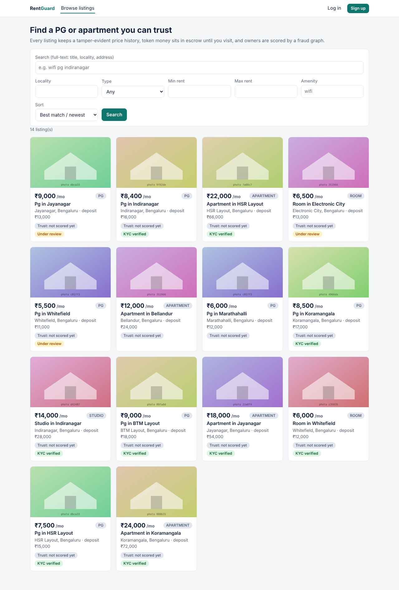{width=6in}

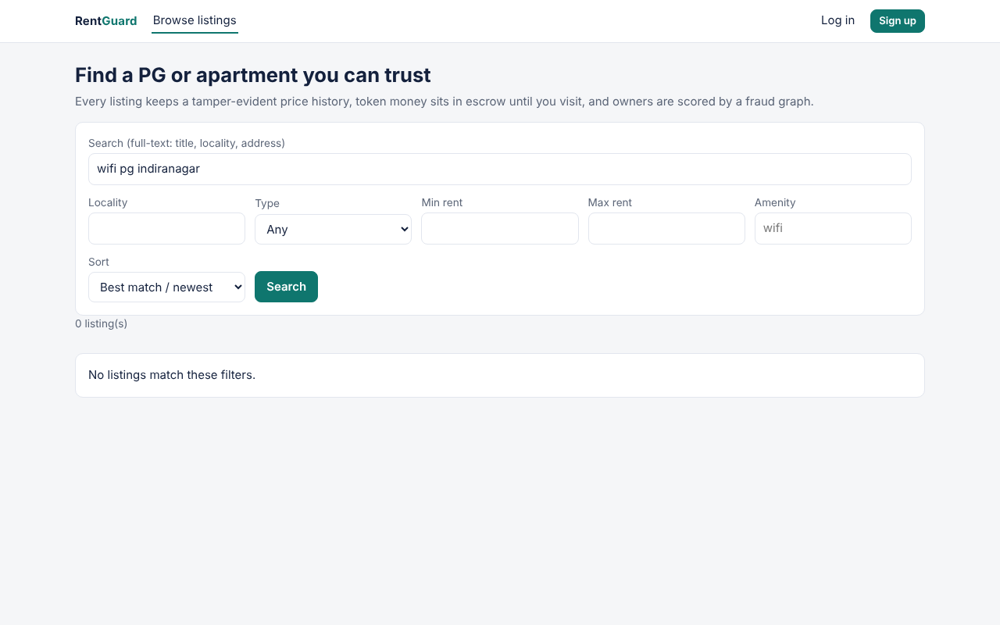{width=6in}

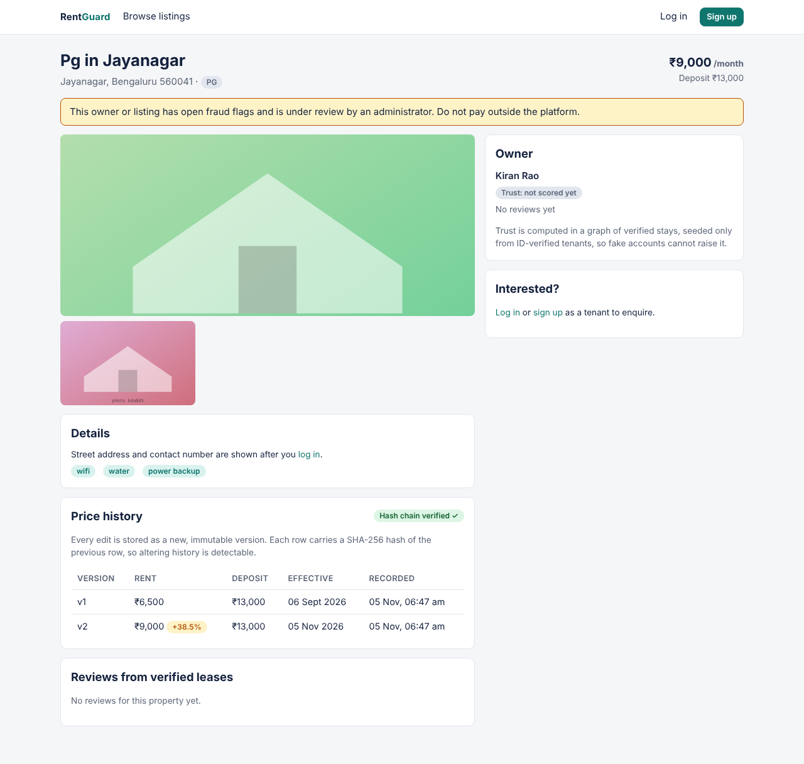{width=6in}

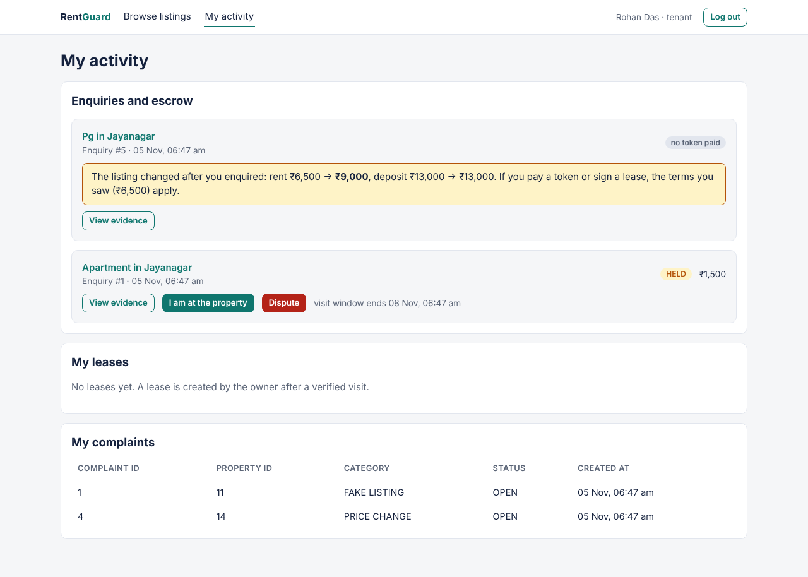{width=6in}

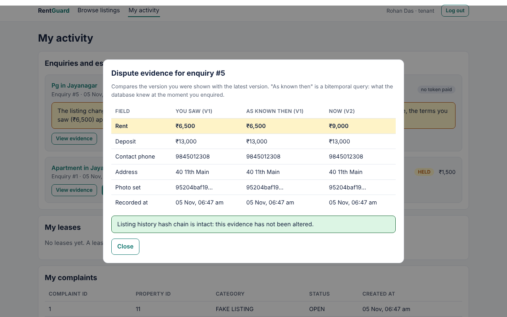{width=6in}

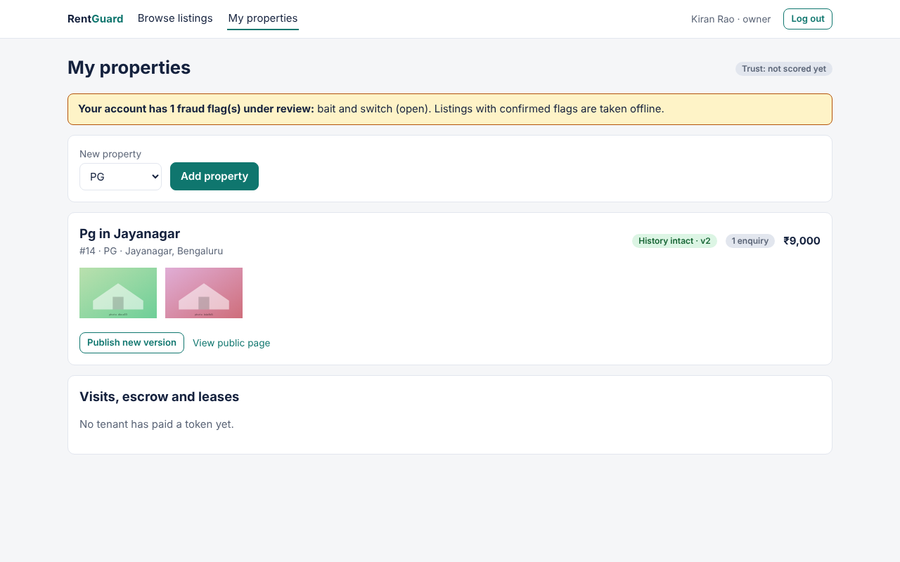{width=6in}

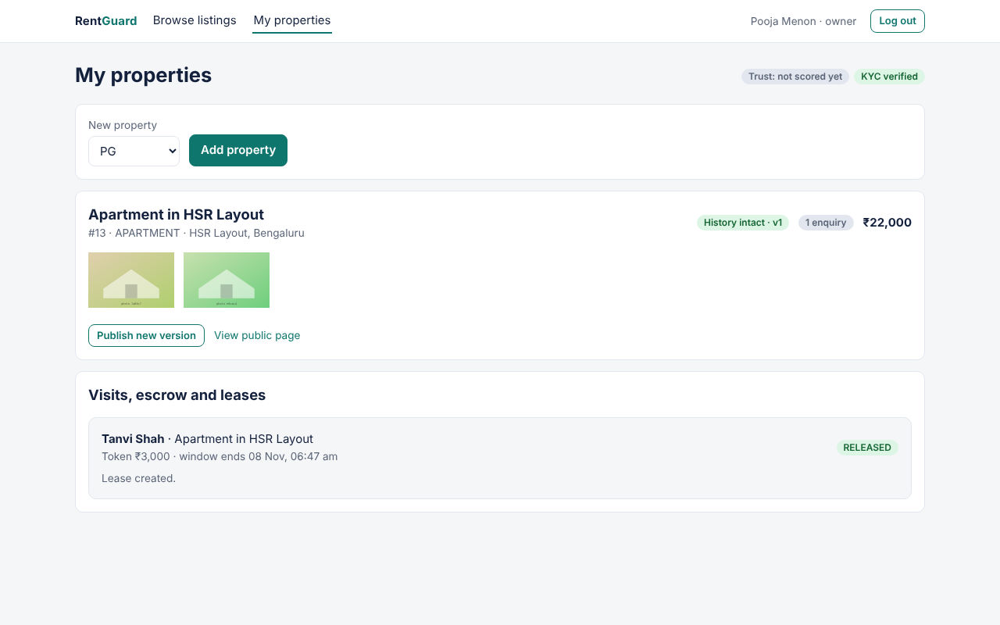{width=6in}

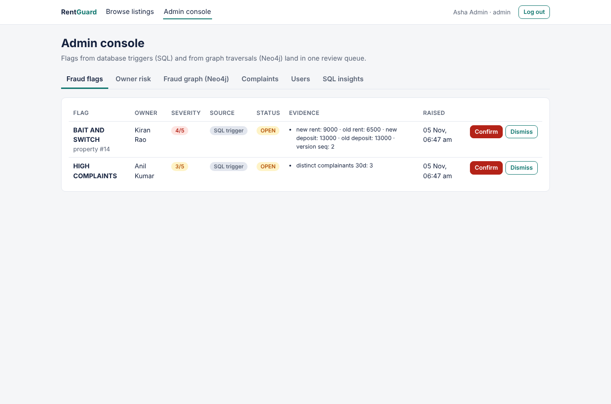{width=6in}

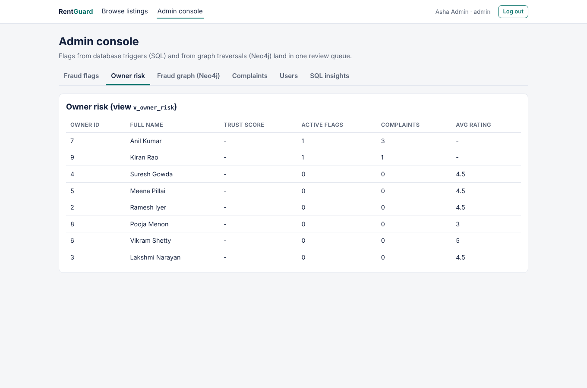{width=6in}

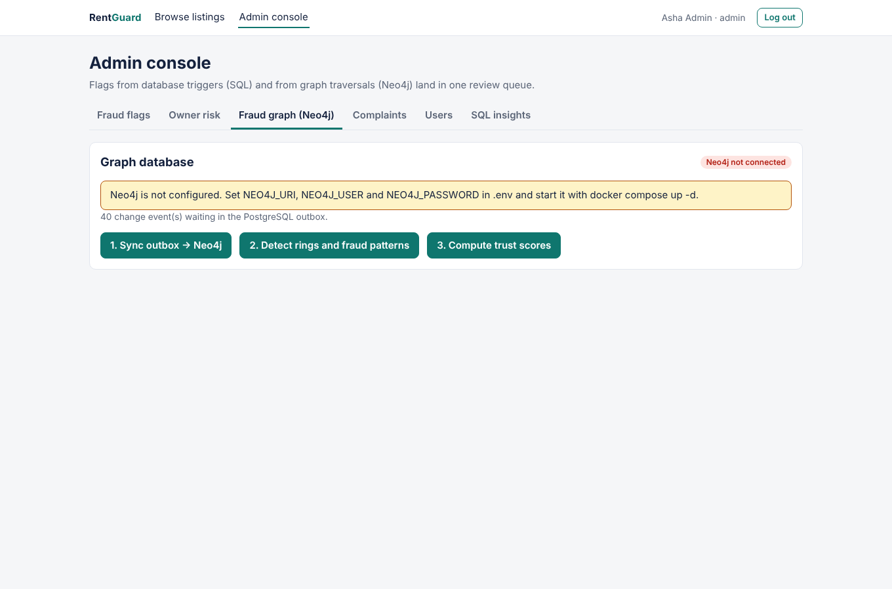{width=6in}

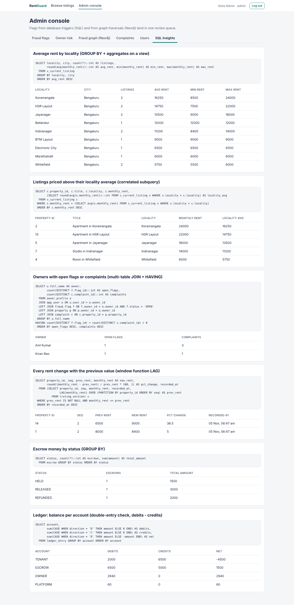{width=6in}

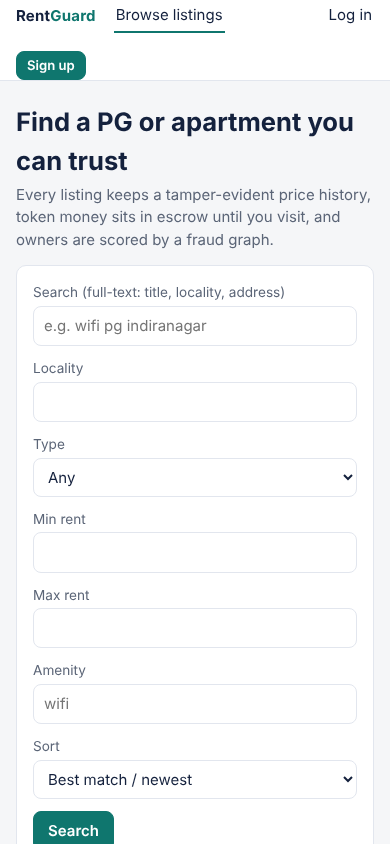{width=6in}

[Insert here: screenshots of the Graph tab with Neo4j connected, showing the cluster of linked owners.]

# 10. Testing

| Suite | Result | What it covers |
|-----------|--------|--------------------------------------------------|
| Unit and Cypher-syntax tests | **32 of 32 pass** | 21 Cypher statements parsed by the official Neo4j parser plus a negative control; address normalisation; transitive clustering; address-only overlap does not cluster; later lister of a shared photo is the suspect; PageRank properties (sums to 1, sybils receive nothing); outbox consumer applies each event once; detection finds the planted ring, the photo thief and the review farm and no honest owner; flag persistence is idempotent and respects dismissals; trust values are written back to SQL |
| End-to-end HTTP tests | **23 of 23 pass** | listing search and filters; SQL-injection style input treated as data; anonymous visitors cannot see street address or phone; login required and role guards; registration validation and unique e-mail; bcrypt storage; wrong-password handling and rate limit; owner publishes with a photo; another owner cannot publish; duplicate enquiry rejected; escrow amount rules, idempotent payment, one-time code, two-party release; lease at the seen rent, overlap rejected, early review rejected; price hike flagged by the trigger; bitemporal evidence with intact chain; three complainants raise a flag; admin confirm takes listing offline; complaints workflow; SQL insights and balanced ledger; graph endpoints degrade gracefully without Neo4j; logout |
| Static checks | pass | TypeScript compile clean; production build succeeds; mobile page has no horizontal overflow |

Raw output: `docs/test-unit.txt` and `docs/test-e2e.txt`.

**Verification scope.** Neo4j was not available in the environment where the tests were run. The graph algorithms were verified against an emulator that reproduces the query results from PostgreSQL data, and every Cypher statement was syntax-checked with the official parser. The queries were not executed on a live Neo4j server; the team should run the sync, detection and trust steps once against the Docker Neo4j instance and record the result (screenshot placeholder in section 9).

# 11. Challenges and design decisions

| Problem | Decision |
|----------------------------|------------------------------|
| Two stores can drift apart if the application writes to both | Transactional outbox: the event is written in the same transaction as the change; idempotent `MERGE` makes replays harmless |
| `now()` is frozen at transaction start, which made "what was known at the enquiry" wrong inside one transaction | Use `clock_timestamp()` for both listing time and enquiry time |
| Debits and credits are inserted row by row | Constraint trigger deferred to COMMIT |
| A shared address between owners is often innocent (PG buildings, family) | Weighted evidence: phone and photo link owners, address alone does not |
| Fake tenants could inflate owner reputation | Personalised PageRank restarting only at ID-verified tenants |
| Admin judged a graph finding to be a false positive | Dismissed flags suppress identical future findings |
| Exact photo hashing misses edited copies | Documented limitation; future work |

# 12. Conclusion

RentGuard shows why a hybrid design is justified. Relational guarantees protect money and history; a graph exposes collusion that row-by-row rules cannot see; and the database itself rejects invalid or tampered data, so the rules hold for every client. The project uses transactions, stored procedures, eight trigger functions (twelve triggers), views, full-text search, advanced indexing, an exclusion constraint, bitemporal modelling and a graph algorithm, behind role-based access control and a tested API.

# 13. Future work

Perceptual hashing or pgvector similarity to catch edited copies of photos; an administrator resolution screen for disputed escrow (the state machine already allows it); a real payment gateway and geofenced check-in; per-escrow attempt limits on the visit code; a shared (Redis) rate limiter; scheduled sync and detection jobs; deactivated users rejected on every request rather than at login.

# 14. Team contribution

| Member | Responsibility |
|-------|-----------------------------------------------|
| Member A | Listing integrity and graph: `db/01_listing.sql` (users, profiles, property, hash-chained listing history, bitemporal functions, bait-and-switch trigger, outbox, full-text search, `v_current_listing`), all Neo4j work (model, Cypher, clustering, PageRank, sync), listing search, detail and publishing APIs and pages, unit tests, ER diagram and data dictionary |
| Member B | Money, workflow and access: `db/02_workflow.sql` (inquiry, lease with EXCLUDE, escrow and its four procedures, double-entry ledger, review, complaint, fraud flag, their triggers and two views), authentication and role-based access, server plumbing, tenant and admin consoles, end-to-end tests, architecture diagram, screenshots |
| Both | seed data, documentation, demo |

# 15. How to run

```
cp .env.example .env     # set POSTGRES_PASSWORD, DATABASE_URL, NEO4J_PASSWORD, SESSION_SECRET (>= 32 chars)
docker compose up -d     # PostgreSQL (schema + seed loaded automatically) and Neo4j
npm install
npm run graph:sync
npm run build && npm run start     # http://localhost:3000
```
Demo accounts (seed data only) use the password `Passw0rd!`: `admin@rentguard.test`, `ramesh@rentguard.test` (owner), `t10@rentguard.test` (tenant). The demo visit code of the seeded held escrow is `111111`.

# Appendix A: Data dictionary

Generated from the live PostgreSQL schema.


Generated from the live PostgreSQL schema (`information_schema`, `pg_constraint`, `pg_indexes`, `pg_trigger`). 14 tables.

### `app_user`

| Column | Type | Null? | Default |
|---|---|---|---|
| `user_id` | bigint | no |  |
| `email` | text | no |  |
| `password_hash` | text | no |  |
| `role` | user_role | no |  |
| `full_name` | text | no |  |
| `phone` | text | no |  |
| `phone_verified` | boolean | no | `false` |
| `is_active` | boolean | no | `true` |
| `created_at` | timestamp with time zone | no | `now()` |

**Constraints**

- CHECK `app_user_email_check`: `CHECK ((email ~* '^[^@\s]+@[^@\s]+\.[^@\s]+$'::text))`
- CHECK `app_user_full_name_check`: `CHECK ((length(TRIM(BOTH FROM full_name)) > 0))`
- CHECK `app_user_phone_check`: `CHECK ((phone ~ '^\+?[0-9]{10,13}$'::text))`
- PRIMARY KEY `app_user_pkey`: `PRIMARY KEY (user_id)`
- UNIQUE `app_user_email_key`: `UNIQUE (email)`
- UNIQUE `app_user_user_id_role_key`: `UNIQUE (user_id, role)`

**Indexes**

- `app_user_email_key`: `CREATE UNIQUE INDEX app_user_email_key ON public.app_user USING btree (email)`
- `app_user_user_id_role_key`: `CREATE UNIQUE INDEX app_user_user_id_role_key ON public.app_user USING btree (user_id, role)`

### `complaint`

| Column | Type | Null? | Default |
|---|---|---|---|
| `complaint_id` | bigint | no |  |
| `property_id` | bigint | no |  |
| `filed_by` | bigint | no |  |
| `category` | text | no |  |
| `description` | text | no |  |
| `status` | complaint_status | no | `'OPEN'::complaint_status` |
| `resolved_by` | bigint | yes |  |
| `created_at` | timestamp with time zone | no | `now()` |

**Constraints**

- CHECK `complaint_category_check`: `CHECK ((category = ANY (ARRAY['FAKE_LISTING'::text, 'PRICE_CHANGE'::text, 'DEPOSIT_DISPUTE'::text, 'HARASSMENT'::text, 'OTHER'::text])))`
- CHECK `complaint_check`: `CHECK (((status = ANY (ARRAY['OPEN'::complaint_status, 'UNDER_REVIEW'::complaint_status])) OR (resolved_by IS NOT NULL)))`
- CHECK `complaint_description_check`: `CHECK ((length(description) >= 10))`
- FOREIGN KEY `complaint_filed_by_fkey`: `FOREIGN KEY (filed_by) REFERENCES tenant_profile(tenant_id)`
- FOREIGN KEY `complaint_property_id_fkey`: `FOREIGN KEY (property_id) REFERENCES property(property_id)`
- FOREIGN KEY `complaint_resolved_by_fkey`: `FOREIGN KEY (resolved_by) REFERENCES app_user(user_id)`
- PRIMARY KEY `complaint_pkey`: `PRIMARY KEY (complaint_id)`

**Indexes**

- `idx_complaint_prop_time`: `CREATE INDEX idx_complaint_prop_time ON public.complaint USING btree (property_id, created_at DESC)`

**Triggers**

- `trg_flag_complaints`

### `escrow`

| Column | Type | Null? | Default |
|---|---|---|---|
| `escrow_id` | bigint | no |  |
| `inquiry_id` | bigint | no |  |
| `tenant_id` | bigint | no |  |
| `owner_id` | bigint | no |  |
| `amount` | numeric | no |  |
| `status` | escrow_status | no | `'HELD'::escrow_status` |
| `otp_hash` | text | no |  |
| `otp_expires_at` | timestamp with time zone | no |  |
| `tenant_checkin_at` | timestamp with time zone | yes |  |
| `owner_checkin_at` | timestamp with time zone | yes |  |
| `idempotency_key` | uuid | no |  |
| `created_at` | timestamp with time zone | no | `now()` |
| `resolved_at` | timestamp with time zone | yes |  |

**Constraints**

- CHECK `escrow_amount_check`: `CHECK ((amount >= (100)::numeric))`
- CHECK `escrow_check`: `CHECK (((status <> 'RELEASED'::escrow_status) OR ((tenant_checkin_at IS NOT NULL) AND (owner_checkin_at IS NOT NULL))))`
- CHECK `escrow_check1`: `CHECK (((status = ANY (ARRAY['HELD'::escrow_status, 'DISPUTED'::escrow_status])) OR (resolved_at IS NOT NULL)))`
- FOREIGN KEY `escrow_inquiry_id_fkey`: `FOREIGN KEY (inquiry_id) REFERENCES inquiry(inquiry_id)`
- FOREIGN KEY `escrow_owner_id_fkey`: `FOREIGN KEY (owner_id) REFERENCES owner_profile(owner_id)`
- FOREIGN KEY `escrow_tenant_id_fkey`: `FOREIGN KEY (tenant_id) REFERENCES tenant_profile(tenant_id)`
- PRIMARY KEY `escrow_pkey`: `PRIMARY KEY (escrow_id)`
- UNIQUE `escrow_idempotency_key_key`: `UNIQUE (idempotency_key)`
- UNIQUE `escrow_inquiry_id_key`: `UNIQUE (inquiry_id)`

**Indexes**

- `escrow_idempotency_key_key`: `CREATE UNIQUE INDEX escrow_idempotency_key_key ON public.escrow USING btree (idempotency_key)`
- `escrow_inquiry_id_key`: `CREATE UNIQUE INDEX escrow_inquiry_id_key ON public.escrow USING btree (inquiry_id)`
- `idx_escrow_held`: `CREATE INDEX idx_escrow_held ON public.escrow USING btree (created_at) WHERE (status = 'HELD'::escrow_status)`

**Triggers**

- `trg_escrow_transition`

### `fraud_flag`

| Column | Type | Null? | Default |
|---|---|---|---|
| `flag_id` | bigint | no |  |
| `owner_id` | bigint | yes |  |
| `property_id` | bigint | yes |  |
| `flag_type` | text | no |  |
| `severity` | smallint | no |  |
| `source` | text | no |  |
| `status` | flag_status | no | `'OPEN'::flag_status` |
| `evidence` | jsonb | no | `'{}'::jsonb` |
| `reviewed_by` | bigint | yes |  |
| `created_at` | timestamp with time zone | no | `now()` |

**Constraints**

- CHECK `fraud_flag_check`: `CHECK (((owner_id IS NOT NULL) OR (property_id IS NOT NULL)))`
- CHECK `fraud_flag_check1`: `CHECK (((status = 'OPEN'::flag_status) OR (reviewed_by IS NOT NULL)))`
- CHECK `fraud_flag_flag_type_check`: `CHECK ((flag_type = ANY (ARRAY['BAIT_AND_SWITCH'::text, 'DUPLICATE_PHOTO'::text, 'SHARED_CONTACT'::text, 'REVIEW_RING'::text, 'HIGH_COMPLAINTS'::text])))`
- CHECK `fraud_flag_severity_check`: `CHECK (((severity >= 1) AND (severity <= 5)))`
- CHECK `fraud_flag_source_check`: `CHECK ((source = ANY (ARRAY['SQL_TRIGGER'::text, 'GRAPH'::text])))`
- FOREIGN KEY `fraud_flag_owner_id_fkey`: `FOREIGN KEY (owner_id) REFERENCES owner_profile(owner_id)`
- FOREIGN KEY `fraud_flag_property_id_fkey`: `FOREIGN KEY (property_id) REFERENCES property(property_id)`
- FOREIGN KEY `fraud_flag_reviewed_by_fkey`: `FOREIGN KEY (reviewed_by) REFERENCES app_user(user_id)`
- PRIMARY KEY `fraud_flag_pkey`: `PRIMARY KEY (flag_id)`

**Indexes**

- `idx_flag_open`: `CREATE INDEX idx_flag_open ON public.fraud_flag USING btree (created_at DESC) WHERE (status = 'OPEN'::flag_status)`

### `graph_outbox`

| Column | Type | Null? | Default |
|---|---|---|---|
| `outbox_id` | bigint | no |  |
| `event_type` | text | no |  |
| `payload` | jsonb | no |  |
| `created_at` | timestamp with time zone | no | `now()` |
| `processed_at` | timestamp with time zone | yes |  |

**Constraints**

- PRIMARY KEY `graph_outbox_pkey`: `PRIMARY KEY (outbox_id)`

**Indexes**

- `idx_outbox_pending`: `CREATE INDEX idx_outbox_pending ON public.graph_outbox USING btree (outbox_id) WHERE (processed_at IS NULL)`

### `inquiry`

| Column | Type | Null? | Default |
|---|---|---|---|
| `inquiry_id` | bigint | no |  |
| `tenant_id` | bigint | no |  |
| `property_id` | bigint | no |  |
| `seen_version_id` | bigint | no |  |
| `message` | text | yes |  |
| `created_at` | timestamp with time zone | no | `clock_timestamp()` |

**Constraints**

- FOREIGN KEY `inquiry_property_id_fkey`: `FOREIGN KEY (property_id) REFERENCES property(property_id)`
- FOREIGN KEY `inquiry_seen_version_id_property_id_fkey`: `FOREIGN KEY (seen_version_id, property_id) REFERENCES listing_version(version_id, property_id)`
- FOREIGN KEY `inquiry_tenant_id_fkey`: `FOREIGN KEY (tenant_id) REFERENCES tenant_profile(tenant_id)`
- PRIMARY KEY `inquiry_pkey`: `PRIMARY KEY (inquiry_id)`
- UNIQUE `inquiry_tenant_id_property_id_seen_version_id_key`: `UNIQUE (tenant_id, property_id, seen_version_id)`

**Indexes**

- `idx_inquiry_prop_time`: `CREATE INDEX idx_inquiry_prop_time ON public.inquiry USING btree (property_id, created_at DESC)`
- `inquiry_tenant_id_property_id_seen_version_id_key`: `CREATE UNIQUE INDEX inquiry_tenant_id_property_id_seen_version_id_key ON public.inquiry USING btree (tenant_id, property_id, seen_version_id)`

### `lease`

| Column | Type | Null? | Default |
|---|---|---|---|
| `lease_id` | bigint | no |  |
| `property_id` | bigint | no |  |
| `tenant_id` | bigint | no |  |
| `agreed_version_id` | bigint | no |  |
| `start_date` | date | no |  |
| `end_date` | date | no |  |
| `monthly_rent` | numeric | no |  |
| `security_deposit` | numeric | no |  |
| `status` | lease_status | no | `'PENDING'::lease_status` |

**Constraints**

- CHECK `lease_check`: `CHECK ((end_date > start_date))`
- CHECK `lease_monthly_rent_check`: `CHECK ((monthly_rent > (0)::numeric))`
- CHECK `lease_security_deposit_check`: `CHECK ((security_deposit >= (0)::numeric))`
- FOREIGN KEY `lease_agreed_version_id_property_id_fkey`: `FOREIGN KEY (agreed_version_id, property_id) REFERENCES listing_version(version_id, property_id)`
- FOREIGN KEY `lease_property_id_fkey`: `FOREIGN KEY (property_id) REFERENCES property(property_id)`
- FOREIGN KEY `lease_tenant_id_fkey`: `FOREIGN KEY (tenant_id) REFERENCES tenant_profile(tenant_id)`
- PRIMARY KEY `lease_pkey`: `PRIMARY KEY (lease_id)`
- UNIQUE `lease_lease_id_tenant_id_key`: `UNIQUE (lease_id, tenant_id)`
- EXCLUDE `lease_property_id_daterange_excl`: `EXCLUDE USING gist (property_id WITH =, daterange(start_date, end_date, '[)'::text) WITH &&) WHERE ((status = ANY (ARRAY['PENDING'::lease_status, 'ACTIVE'::lease_status])))`

**Indexes**

- `lease_lease_id_tenant_id_key`: `CREATE UNIQUE INDEX lease_lease_id_tenant_id_key ON public.lease USING btree (lease_id, tenant_id)`
- `lease_property_id_daterange_excl`: `CREATE INDEX lease_property_id_daterange_excl ON public.lease USING gist (property_id, daterange(start_date, end_date, '[)'::text)) WHERE (status = ANY (ARRAY['PENDING'::lease_status, 'ACTIVE'::lease_status]))`

**Triggers**

- `trg_outbox_lease`

### `ledger_entry`

| Column | Type | Null? | Default |
|---|---|---|---|
| `entry_id` | bigint | no |  |
| `txn_group` | uuid | no |  |
| `escrow_id` | bigint | no |  |
| `account` | ledger_account | no |  |
| `direction` | character(1) | no |  |
| `amount` | numeric | no |  |
| `posted_at` | timestamp with time zone | no | `now()` |

**Constraints**

- CHECK `ledger_entry_amount_check`: `CHECK ((amount > (0)::numeric))`
- CHECK `ledger_entry_direction_check`: `CHECK ((direction = ANY (ARRAY['D'::bpchar, 'C'::bpchar])))`
- FOREIGN KEY `ledger_entry_escrow_id_fkey`: `FOREIGN KEY (escrow_id) REFERENCES escrow(escrow_id)`
- PRIMARY KEY `ledger_entry_pkey`: `PRIMARY KEY (entry_id)`
- t `trg_ledger_balanced`: `TRIGGER DEFERRABLE INITIALLY DEFERRED`

**Indexes**

- `idx_ledger_group`: `CREATE INDEX idx_ledger_group ON public.ledger_entry USING btree (txn_group)`

**Triggers**

- `trg_ledger_balanced`
- `trg_ledger_immutable`

### `listing_photo`

| Column | Type | Null? | Default |
|---|---|---|---|
| `photo_id` | bigint | no |  |
| `version_id` | bigint | no |  |
| `url` | text | no |  |
| `sha256` | character(64) | no |  |
| `position` | smallint | no | `1` |

**Constraints**

- CHECK `listing_photo_position_check`: `CHECK (("position" > 0))`
- CHECK `listing_photo_sha256_check`: `CHECK ((sha256 ~ '^[0-9a-f]{64}$'::text))`
- FOREIGN KEY `listing_photo_version_id_fkey`: `FOREIGN KEY (version_id) REFERENCES listing_version(version_id)`
- PRIMARY KEY `listing_photo_pkey`: `PRIMARY KEY (photo_id)`
- UNIQUE `listing_photo_version_id_sha256_key`: `UNIQUE (version_id, sha256)`

**Indexes**

- `idx_photo_sha`: `CREATE INDEX idx_photo_sha ON public.listing_photo USING btree (sha256)`
- `listing_photo_version_id_sha256_key`: `CREATE UNIQUE INDEX listing_photo_version_id_sha256_key ON public.listing_photo USING btree (version_id, sha256)`

**Triggers**

- `trg_photo_immutable`

### `listing_version`

| Column | Type | Null? | Default |
|---|---|---|---|
| `version_id` | bigint | no |  |
| `property_id` | bigint | no |  |
| `seq` | integer | no |  |
| `title` | text | no |  |
| `monthly_rent` | numeric | no |  |
| `security_deposit` | numeric | no |  |
| `address_line` | text | no |  |
| `locality` | text | no |  |
| `city` | text | no |  |
| `pincode` | character(6) | no |  |
| `contact_phone` | text | no |  |
| `amenities` | jsonb | no | `'[]'::jsonb` |
| `effective_from` | date | no |  |
| `recorded_at` | timestamp with time zone | no | `now()` |
| `recorded_by` | bigint | no |  |
| `photo_digest` | text | no | `''::text` |
| `prev_hash` | text | yes |  |
| `row_hash` | text | no |  |

**Constraints**

- CHECK `listing_version_contact_phone_check`: `CHECK ((contact_phone ~ '^\+?[0-9]{10,13}$'::text))`
- CHECK `listing_version_monthly_rent_check`: `CHECK ((monthly_rent > (0)::numeric))`
- CHECK `listing_version_pincode_check`: `CHECK ((pincode ~ '^[0-9]{6}$'::text))`
- CHECK `listing_version_security_deposit_check`: `CHECK ((security_deposit >= (0)::numeric))`
- CHECK `listing_version_title_check`: `CHECK ((length(TRIM(BOTH FROM title)) > 0))`
- FOREIGN KEY `listing_version_property_id_fkey`: `FOREIGN KEY (property_id) REFERENCES property(property_id)`
- FOREIGN KEY `listing_version_recorded_by_fkey`: `FOREIGN KEY (recorded_by) REFERENCES app_user(user_id)`
- PRIMARY KEY `listing_version_pkey`: `PRIMARY KEY (version_id)`
- UNIQUE `listing_version_property_id_seq_key`: `UNIQUE (property_id, seq)`
- UNIQUE `listing_version_version_id_property_id_key`: `UNIQUE (version_id, property_id)`

**Indexes**

- `idx_lv_amenities`: `CREATE INDEX idx_lv_amenities ON public.listing_version USING gin (amenities)`
- `idx_lv_contact_phone`: `CREATE INDEX idx_lv_contact_phone ON public.listing_version USING btree (contact_phone)`
- `idx_lv_property_valid`: `CREATE INDEX idx_lv_property_valid ON public.listing_version USING btree (property_id, effective_from DESC, seq DESC)`
- `idx_lv_recorded`: `CREATE INDEX idx_lv_recorded ON public.listing_version USING btree (property_id, recorded_at)`
- `idx_lv_search`: `CREATE INDEX idx_lv_search ON public.listing_version USING gin (to_tsvector('english'::regconfig, ((((title \|\| ' '::text) \|\| locality) \|\| ' '::text) \|\| address_line)))`
- `listing_version_property_id_seq_key`: `CREATE UNIQUE INDEX listing_version_property_id_seq_key ON public.listing_version USING btree (property_id, seq)`
- `listing_version_version_id_property_id_key`: `CREATE UNIQUE INDEX listing_version_version_id_property_id_key ON public.listing_version USING btree (version_id, property_id)`

**Triggers**

- `trg_flag_bait_switch`
- `trg_listing_chain`
- `trg_lv_immutable`
- `trg_outbox_listing`

### `owner_profile`

| Column | Type | Null? | Default |
|---|---|---|---|
| `owner_id` | bigint | no |  |
| `role` | user_role | no | `'OWNER'::user_role` |
| `kyc_verified` | boolean | no | `false` |
| `trust_score` | numeric | no | `0` |
| `trust_updated_at` | timestamp with time zone | yes |  |

**Constraints**

- CHECK `owner_profile_role_check`: `CHECK ((role = 'OWNER'::user_role))`
- CHECK `owner_profile_trust_score_check`: `CHECK (((trust_score >= (0)::numeric) AND (trust_score <= (1)::numeric)))`
- FOREIGN KEY `owner_profile_owner_id_role_fkey`: `FOREIGN KEY (owner_id, role) REFERENCES app_user(user_id, role) ON DELETE CASCADE`
- PRIMARY KEY `owner_profile_pkey`: `PRIMARY KEY (owner_id)`

### `property`

| Column | Type | Null? | Default |
|---|---|---|---|
| `property_id` | bigint | no |  |
| `owner_id` | bigint | no |  |
| `property_type` | text | no |  |
| `is_active` | boolean | no | `true` |
| `created_at` | timestamp with time zone | no | `now()` |

**Constraints**

- CHECK `property_property_type_check`: `CHECK ((property_type = ANY (ARRAY['APARTMENT'::text, 'PG'::text, 'ROOM'::text, 'STUDIO'::text])))`
- FOREIGN KEY `property_owner_id_fkey`: `FOREIGN KEY (owner_id) REFERENCES owner_profile(owner_id)`
- PRIMARY KEY `property_pkey`: `PRIMARY KEY (property_id)`

**Indexes**

- `idx_property_owner`: `CREATE INDEX idx_property_owner ON public.property USING btree (owner_id)`

### `review`

| Column | Type | Null? | Default |
|---|---|---|---|
| `review_id` | bigint | no |  |
| `lease_id` | bigint | no |  |
| `tenant_id` | bigint | no |  |
| `rating` | smallint | no |  |
| `comment` | text | yes |  |
| `created_at` | timestamp with time zone | no | `now()` |

**Constraints**

- CHECK `review_rating_check`: `CHECK (((rating >= 1) AND (rating <= 5)))`
- FOREIGN KEY `review_lease_id_tenant_id_fkey`: `FOREIGN KEY (lease_id, tenant_id) REFERENCES lease(lease_id, tenant_id)`
- PRIMARY KEY `review_pkey`: `PRIMARY KEY (review_id)`
- UNIQUE `review_lease_id_key`: `UNIQUE (lease_id)`

**Indexes**

- `review_lease_id_key`: `CREATE UNIQUE INDEX review_lease_id_key ON public.review USING btree (lease_id)`

**Triggers**

- `trg_outbox_review`
- `trg_review_guard`

### `tenant_profile`

| Column | Type | Null? | Default |
|---|---|---|---|
| `tenant_id` | bigint | no |  |
| `role` | user_role | no | `'TENANT'::user_role` |
| `occupation` | text | yes |  |
| `id_verified` | boolean | no | `false` |

**Constraints**

- CHECK `tenant_profile_role_check`: `CHECK ((role = 'TENANT'::user_role))`
- FOREIGN KEY `tenant_profile_tenant_id_role_fkey`: `FOREIGN KEY (tenant_id, role) REFERENCES app_user(user_id, role) ON DELETE CASCADE`
- PRIMARY KEY `tenant_profile_pkey`: `PRIMARY KEY (tenant_id)`

### Views

- `v_current_listing`
- `v_escrow_summary`
- `v_owner_risk`

### Stored procedures and functions

- `fn_block_mutation` (function)
- `fn_escrow_transition` (function)
- `fn_flag_bait_switch` (function)
- `fn_flag_complaints` (function)
- `fn_ledger_balanced` (function)
- `fn_listing_as_of` (function)
- `fn_listing_chain` (function)
- `fn_listing_hash` (function)
- `fn_outbox` (function)
- `fn_review_guard` (function)
- `fn_verify_listing_chain` (function)
- `sp_publish_listing` (function)
- `sp_checkin` (procedure)
- `sp_hold_escrow` (procedure)
- `sp_refund_escrow` (procedure)
- `sp_release_escrow` (procedure)


# Appendix B: Selected source code

## B.1 Hash-chain trigger (`db/01_listing.sql`)
```sql
CREATE FUNCTION fn_listing_chain() RETURNS trigger
LANGUAGE plpgsql AS $$
DECLARE
    v_last_hash TEXT;
    v_last_seq  INT;
BEGIN
    PERFORM 1 FROM property WHERE property_id = NEW.property_id FOR UPDATE;

    SELECT row_hash, seq INTO v_last_hash, v_last_seq
    FROM listing_version
    WHERE property_id = NEW.property_id
    ORDER BY seq DESC
    LIMIT 1;

    NEW.seq         := COALESCE(v_last_seq, 0) + 1;
    NEW.prev_hash   := v_last_hash;
    NEW.recorded_at := clock_timestamp();
    NEW.row_hash    := fn_listing_hash(NEW);
    RETURN NEW;
END $$;

CREATE TRIGGER trg_listing_chain
    BEFORE INSERT ON listing_version
    FOR EACH ROW EXECUTE FUNCTION fn_listing_chain();
```

## B.2 Bait-and-switch trigger (`db/01_listing.sql`)
```sql
CREATE FUNCTION fn_flag_bait_switch() RETURNS trigger
LANGUAGE plpgsql AS $$
DECLARE
    v_prev  listing_version%ROWTYPE;
    v_owner BIGINT;
BEGIN
    IF NEW.seq = 1 THEN
        RETURN NEW;
    END IF;

    SELECT * INTO v_prev FROM listing_version
     WHERE property_id = NEW.property_id AND seq = NEW.seq - 1;

    IF (NEW.monthly_rent > v_prev.monthly_rent * 1.15
        OR NEW.security_deposit > v_prev.security_deposit * 1.50)
       AND EXISTS (SELECT 1 FROM inquiry
                    WHERE property_id = NEW.property_id
                      AND created_at > NEW.recorded_at - INTERVAL '14 days') THEN

        SELECT owner_id INTO v_owner FROM property WHERE property_id = NEW.property_id;

        INSERT INTO fraud_flag (owner_id, property_id, flag_type, severity, source, evidence)
        VALUES (v_owner, NEW.property_id, 'BAIT_AND_SWITCH', 4, 'SQL_TRIGGER',
                jsonb_build_object(
                    'old_rent', v_prev.monthly_rent,  'new_rent', NEW.monthly_rent,
                    'old_deposit', v_prev.security_deposit, 'new_deposit', NEW.security_deposit,
                    'version_seq', NEW.seq));
    END IF;
    RETURN NEW;
END $$;

CREATE TRIGGER trg_flag_bait_switch
    AFTER INSERT ON listing_version
    FOR EACH ROW EXECUTE FUNCTION fn_flag_bait_switch();
```

## B.3 Escrow: hold and check-in procedures (`db/02_workflow.sql`)
```sql
CREATE PROCEDURE sp_hold_escrow(p_inquiry_id BIGINT, p_amount NUMERIC, p_otp TEXT, p_key UUID)
LANGUAGE plpgsql AS $$
DECLARE
    v_inq   inquiry%ROWTYPE;
    v_owner BIGINT;
    v_rent  NUMERIC;
    v_id    BIGINT;
    v_grp   UUID := gen_random_uuid();
BEGIN
    SELECT * INTO v_inq FROM inquiry WHERE inquiry_id = p_inquiry_id;
    IF NOT FOUND THEN RAISE EXCEPTION 'inquiry % not found', p_inquiry_id; END IF;

    SELECT owner_id INTO v_owner FROM property WHERE property_id = v_inq.property_id;
    SELECT monthly_rent INTO v_rent FROM listing_version WHERE version_id = v_inq.seen_version_id;
    IF p_amount > v_rent THEN
        RAISE EXCEPTION 'token amount % exceeds one month rent %', p_amount, v_rent;
    END IF;

    INSERT INTO escrow (inquiry_id, tenant_id, owner_id, amount, otp_hash, otp_expires_at, idempotency_key)
    VALUES (p_inquiry_id, v_inq.tenant_id, v_owner, p_amount,
            crypt(p_otp, gen_salt('bf')), now() + INTERVAL '72 hours', p_key)
    ON CONFLICT (idempotency_key) DO NOTHING
    RETURNING escrow_id INTO v_id;

    IF v_id IS NULL THEN
        RETURN;                                   -- replayed request, nothing to do
    END IF;

    INSERT INTO ledger_entry (txn_group, escrow_id, account, direction, amount) VALUES
        (v_grp, v_id, 'ESCROW', 'D', p_amount),
        (v_grp, v_id, 'TENANT', 'C', p_amount);
END $$;

CREATE PROCEDURE sp_checkin(p_escrow_id BIGINT, p_user_id BIGINT, p_otp TEXT DEFAULT NULL)
LANGUAGE plpgsql AS $$
DECLARE
    e escrow%ROWTYPE;
BEGIN
    SELECT * INTO e FROM escrow WHERE escrow_id = p_escrow_id FOR UPDATE;
    IF NOT FOUND THEN RAISE EXCEPTION 'escrow % not found', p_escrow_id; END IF;
    IF e.status <> 'HELD' THEN RAISE EXCEPTION 'escrow is not in HELD state'; END IF;
    IF now() > e.otp_expires_at THEN RAISE EXCEPTION 'visit window expired'; END IF;

    IF p_user_id = e.tenant_id THEN
        UPDATE escrow SET tenant_checkin_at = now() WHERE escrow_id = p_escrow_id;
    ELSIF p_user_id = e.owner_id THEN
        IF p_otp IS NULL OR crypt(p_otp, e.otp_hash) <> e.otp_hash THEN
            RAISE EXCEPTION 'invalid OTP';
        END IF;
        UPDATE escrow SET owner_checkin_at = now() WHERE escrow_id = p_escrow_id;
    ELSE
        RAISE EXCEPTION 'user % is not a party to escrow %', p_user_id, p_escrow_id;
    END IF;

    IF EXISTS (SELECT 1 FROM escrow
                WHERE escrow_id = p_escrow_id
                  AND tenant_checkin_at IS NOT NULL
                  AND owner_checkin_at  IS NOT NULL) THEN
        CALL sp_release_escrow(p_escrow_id);
    END IF;
END $$;
```

## B.4 Double-entry ledger check (`db/02_workflow.sql`)
```sql
CREATE FUNCTION fn_ledger_balanced() RETURNS trigger
LANGUAGE plpgsql AS $$
DECLARE
    v_d NUMERIC;
    v_c NUMERIC;
BEGIN
    SELECT COALESCE(SUM(amount) FILTER (WHERE direction = 'D'), 0),
           COALESCE(SUM(amount) FILTER (WHERE direction = 'C'), 0)
      INTO v_d, v_c
      FROM ledger_entry WHERE txn_group = NEW.txn_group;

    IF v_d <> v_c THEN
        RAISE EXCEPTION 'unbalanced ledger transaction % (debits %, credits %)',
                        NEW.txn_group, v_d, v_c;
    END IF;
    RETURN NULL;
END $$;

CREATE CONSTRAINT TRIGGER trg_ledger_balanced
    AFTER INSERT ON ledger_entry
    DEFERRABLE INITIALLY DEFERRED
    FOR EACH ROW EXECUTE FUNCTION fn_ledger_balanced();
```

## B.5 Lease table with overlap exclusion (`db/02_workflow.sql`)
```sql
CREATE TABLE lease (
    lease_id          BIGINT GENERATED ALWAYS AS IDENTITY PRIMARY KEY,
    property_id       BIGINT        NOT NULL REFERENCES property (property_id),
    tenant_id         BIGINT        NOT NULL REFERENCES tenant_profile (tenant_id),
    agreed_version_id BIGINT        NOT NULL,
    start_date        DATE          NOT NULL,
    end_date          DATE          NOT NULL,
    monthly_rent      NUMERIC(10,2) NOT NULL CHECK (monthly_rent > 0),
    security_deposit  NUMERIC(10,2) NOT NULL CHECK (security_deposit >= 0),
    status            lease_status  NOT NULL DEFAULT 'PENDING',
    CHECK (end_date > start_date),
    FOREIGN KEY (agreed_version_id, property_id)
        REFERENCES listing_version (version_id, property_id),
    UNIQUE (lease_id, tenant_id),
    -- no two live leases may overlap on the same property
    EXCLUDE USING gist (
        property_id WITH =,
        daterange(start_date, end_date, '[)') WITH &&
    ) WHERE (status IN ('PENDING', 'ACTIVE'))
);
```

## B.6 Personalised PageRank (`src/lib/graph/algorithms.ts`)
```ts
export function personalizedPageRank(
  edges: { a: string; b: string; w: number }[],
  seeds: string[],
  alpha = 0.85,
  maxIter = 200,
  tol = 1e-12,
): Map<string, number> {
  const adj = new Map<string, Map<string, number>>();
  const link = (u: string, v: string, w: number) => {
    if (!adj.has(u)) adj.set(u, new Map());
    adj.get(u)!.set(v, (adj.get(u)!.get(v) ?? 0) + w);
  };
  for (const e of edges) {
    link(e.a, e.b, e.w);
    link(e.b, e.a, e.w);
  }
  const nodes = [...adj.keys()];
  const seedSet = [...new Set(seeds)].filter((s) => adj.has(s));
  const scores = new Map<string, number>(nodes.map((n) => [n, 0]));
  if (seedSet.length === 0) return scores;

  const teleport = new Map<string, number>(seedSet.map((s) => [s, 1 / seedSet.length]));
  let p = new Map<string, number>(nodes.map((n) => [n, teleport.get(n) ?? 0]));
  const outW = new Map<string, number>();
  for (const [u, nb] of adj) outW.set(u, [...nb.values()].reduce((x, y) => x + y, 0));

  for (let it = 0; it < maxIter; it++) {
    const next = new Map<string, number>(nodes.map((n) => [n, (1 - alpha) * (teleport.get(n) ?? 0)]));
    for (const [u, nb] of adj) {
      const share = alpha * (p.get(u) ?? 0);
      const total = outW.get(u)!;
      for (const [v, w] of nb) next.set(v, next.get(v)! + (share * w) / total);
    }
    let diff = 0;
    for (const n of nodes) diff += Math.abs(next.get(n)! - (p.get(n) ?? 0));
    p = next;
    if (diff < tol) break;
  }
  return p;
}
```
