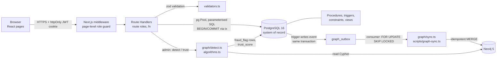
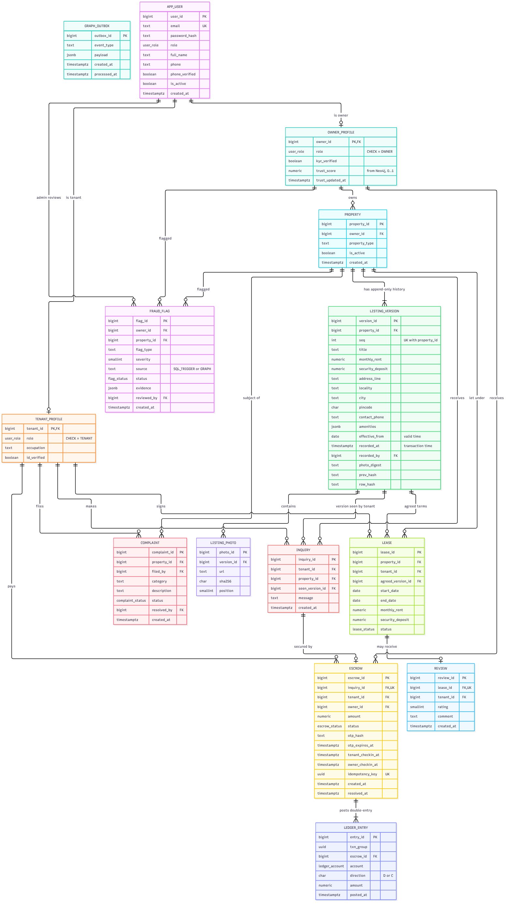
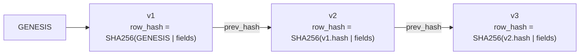
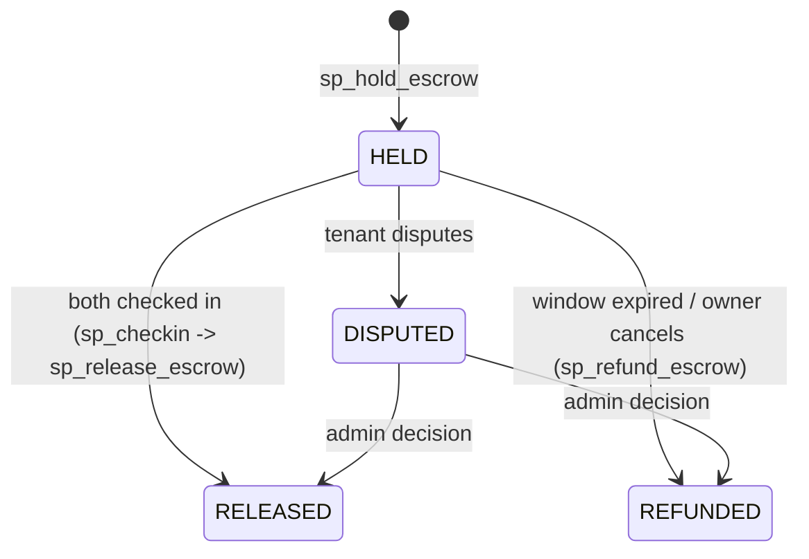

# RentGuard: complete project guide

How the whole project works, why each decision was made, and where to find it in the code. Written so either team member can answer viva questions from it. Mermaid blocks render on GitHub; PNG versions of the two main diagrams are in `docs/`.

Contents: 1 Idea - 2 Architecture - 3 Repository map - 4 Data model (SQL) - 5 The three "non-CRUD" features - 6 Triggers, procedures, views, indexes - 7 Neo4j layer - 8 Next.js application - 9 Security - 10 Seed data and demo story - 11 Testing - 12 Design decisions and trade-offs - 13 Limitations - 14 Viva Q&A - 15 Run it

---

## 1. The idea in one page

A rental marketplace where the dishonest moves are made **technically hard or visible**:

| Fraud pattern | How RentGuard answers it | Where |
|---|---|---|
| "Price was 6,500 when I enquired, now it's 9,000" | Every listing edit is an immutable row in a SHA-256 hash chain. An enquiry pins the exact version the tenant saw. A trigger flags big jumps after interest. A bitemporal query proves what the database knew at that moment. | PostgreSQL |
| One scammer, many identities | Owners, phones, addresses and photo hashes form a graph. Shared phone/photo links cluster "different" owners; trust is a personalised PageRank that only ID-verified tenants can feed. | Neo4j |
| Token money taken then owner vanishes | Token goes to an escrow account in a double-entry ledger; released only when tenant checks in **and** owner enters the tenant's one-time code. | PostgreSQL |

Roles: **Tenant** (search, enquire, pay token, review, complain), **Owner** (publish versions, confirm visits, create leases), **Admin** (review flags, run graph jobs, manage complaints and verification).

Why these were chosen: the professor asked for a twist "an LLM would not suggest in one prompt". Duplicate-listing detection via a graph is the obvious answer, so we added the evidence layer (hash chain + bitemporality), sybil-resistant trust, and escrow on top.

---

## 2. Architecture



Key idea: **PostgreSQL is the single source of truth**. Neo4j is a *derived projection* that can be thrown away and rebuilt from Postgres. Results of graph analysis are written back to Postgres (`fraud_flag`, `owner_profile.trust_score`), so the app has one place to read from and keeps working if Neo4j is down (the Graph tab shows "not connected", other pages are unaffected).

Request life cycle, e.g. a tenant pays a token:

```mermaid
sequenceDiagram
  participant T as Tenant browser
  participant M as middleware
  participant R as POST /api/escrow
  participant P as PostgreSQL
  T->>M: request + rg_session cookie
  M->>R: allowed (cookie valid)
  R->>R: route(['TENANT']) verifies JWT + role
  R->>R: zod parses body, owns the inquiry?
  R->>R: replay check on idempotency key
  R->>R: generate 6-digit OTP (randomInt)
  R->>P: BEGIN; CALL sp_hold_escrow(...); COMMIT
  P->>P: INSERT escrow (bcrypt OTP hash), INSERT ledger D/C
  P->>P: deferred trigger checks debits = credits at COMMIT
  R-->>T: escrowId + OTP (shown once)
```

---

## 3. Repository map

```
db/
  01_listing.sql        users, property, hash-chained listing_version, bitemporal functions, outbox (Member A)
  02_workflow.sql       inquiry, lease, escrow, ledger, review, complaint, flags, procedures, views (Member B)
  seed.sql              demo data with planted fraud scenarios
  neo4j_model.cypher    generated from src/lib/graph/cypher.ts (documentation of every Cypher statement)
  er_diagram.mmd, architecture.mmd   Mermaid sources for docs/*.png
src/lib/
  env.ts      lazy env getters, fails fast on missing / short secrets
  db.ts       pg Pool + query/one/tx helpers; numeric->number, DATE->string
  session.ts  JWT (jose, HS256, 8h) sign/verify; cookies.ts sets httpOnly cookie
  http.ts     route(roles, fn) wrapper, HttpError, PostgreSQL error -> HTTP mapping
  validators.ts   zod schemas for every input
  rateLimit.ts    in-memory login/sign-up limiter
  photos.ts       content-addressed upload (SHA-256 filename, magic-byte check), placeholder SVG
  client.tsx      fetch helpers + React hooks (useApi, useAction) + formatters
  neo4j.ts, graphApi.ts   driver wrapper, "configured / connected" status
  graph/
    cypher.ts      every Cypher string
    algorithms.ts  union-find clustering, finding derivation, personalised PageRank (pure functions)
    sync.ts        outbox consumer (applyEvent, runSync)
    detect.ts      run queries -> findings -> fraud_flag; computeTrust
src/middleware.ts   redirects by role for /tenant /owner /admin
src/app/api/        route handlers (auth, listings, inquiries, escrow, leases, reviews, complaints, owner/*, admin/*)
src/app/            pages: / (search), listings/[id], login, register, tenant, owner, admin
scripts/graph-sync.ts   CLI: outbox -> Neo4j (--watch)
tests/              unit.test.ts, cypher-syntax.test.ts, e2e.test.ts
docs/               REPORT.md, DEMO.md, data-dictionary.md, this guide, diagrams, screenshots, test logs
```

---

## 4. The relational model (PostgreSQL)

### 4.1 ER diagram


### 4.2 Tables at a glance

| Table | Purpose | Notable constraints |
|---|---|---|
| `app_user` | every account; `role` enum TENANT/OWNER/ADMIN | email regex CHECK, UNIQUE email, phone regex, `UNIQUE (user_id, role)` as FK target, bcrypt hash |
| `owner_profile` / `tenant_profile` | role-specific data (kyc / id_verified, trust_score) | `role` column pinned by CHECK + composite FK `(id, role) -> app_user(user_id, role)`: an owner profile cannot point at a tenant |
| `property` | stable identity of one rentable unit | type CHECK, `is_active` (admin takedown) |
| `listing_version` | **append-only** history of every listing edit | rent > 0, deposit >= 0, pincode/phone regex, `UNIQUE(property_id, seq)`, hash chain columns |
| `listing_photo` | photos per version with SHA-256 | sha regex, `UNIQUE(version_id, sha256)`, append-only |
| `inquiry` | tenant interest, **pins** `seen_version_id` | composite FK `(seen_version_id, property_id)` so the version must belong to that property |
| `lease` | agreed tenancy | `end_date > start_date`, **EXCLUDE USING gist** no two live leases overlap per property |
| `escrow` | token money state machine | amount >= 100, CHECK "RELEASED only if both checked in", `idempotency_key UNIQUE`, `otp_hash` |
| `ledger_entry` | double-entry postings | direction D/C, amount > 0, append-only |
| `review` | one per lease | `UNIQUE(lease_id)`, FK `(lease_id, tenant_id)` so only that tenant can review, 30-day guard trigger |
| `complaint` | tenant reports | category CHECK, description >= 10 chars, resolved status needs `resolved_by` |
| `fraud_flag` | review queue; source SQL_TRIGGER or GRAPH | type/severity CHECKs, evidence JSONB, non-OPEN needs `reviewed_by` |
| `graph_outbox` | transactional outbox for Neo4j | partial index on unprocessed rows |

Full column-level listing: [data-dictionary.md](data-dictionary.md).

### 4.3 Why it is normalised this way
- **3NF:** user data once in `app_user`; role data in profile tables; listing terms in `listing_version`; no derived value stored except deliberate ones (`trust_score`, hash columns).
- **property vs listing_version split:** a property has one identity but many versions of its terms. Without the split you must update rows in place and lose history.
- **Composite FKs** push business rules into the schema: you cannot enquire about version 12 of property 3 if version 12 belongs to property 5; you cannot create an owner profile for a tenant.
- **JSONB for amenities** (flexible, GIN-indexed `?` lookups) instead of a join table, because amenities are free-form tags only searched by membership.
- **Enums** for roles and states so invalid values cannot exist.

---

## 5. The three "non-CRUD" features in detail

### 5.1 Tamper-evident, bitemporal listing history

Two clocks on every row:
- `effective_from` = **valid time**: when the terms apply (chosen by the owner).
- `recorded_at` = **transaction time**: when the database learned it, set by the trigger with `clock_timestamp()` (owner cannot back-date it).

Hash chain (per property):



How it works (all in `db/01_listing.sql`):
1. `sp_publish_listing(...)` inserts the new row and its photos in one transaction. It checks ownership and computes `photo_digest` = SHA-256 of the sorted photo hashes, so changing photos changes the hash.
2. BEFORE INSERT trigger `fn_listing_chain` locks the parent `property` row (`FOR UPDATE`, serialising concurrent edits), takes the last row's hash and seq, sets `seq`, `prev_hash`, `recorded_at`, and `row_hash = fn_listing_hash(NEW)`.
3. `fn_block_mutation` triggers reject any UPDATE/DELETE on `listing_version`, `listing_photo`, `ledger_entry`.
4. `fn_verify_listing_chain(property)` recomputes each hash and compares `prev_hash` with the previous row's hash using `LAG`. If someone edits a row with a superuser bypass, `intact` becomes false and the UI shows "Tamper detected".

Bitemporal query: `fn_listing_as_of(property, known_at, valid_on)` returns the latest version with `recorded_at <= known_at AND effective_from <= valid_on`. The dispute screen shows three columns: what the tenant **saw** (pinned FK), what the database **knew then**, and **now**.

Bait-and-switch trigger `fn_flag_bait_switch` (AFTER INSERT): if rent rises more than 15% or deposit more than 50% versus the previous version **and** an inquiry exists within the last 14 days, a `fraud_flag` (severity 4) is created with old/new values.

Price lock: leases copy rent/deposit from the version the tenant saw (`agreed_version_id`), so a later increase does not apply.

Design note: `inquiry.created_at` uses `clock_timestamp()`, not `now()`, so it shares a clock with `recorded_at` even if both happen in one transaction (this was a real bug found in testing).

### 5.2 Escrowed token money



The legal transitions are enforced by trigger `fn_escrow_transition`, not by the app. (The admin resolution UI for DISPUTED is listed as future work; the database already permits it.)

Flow:
1. Tenant pays token (min 100, at most one month's rent as seen). The API generates a 6-digit OTP, passes it to `sp_hold_escrow`, which stores only `crypt(otp, gen_salt('bf'))`. The OTP is returned once. The visit window is 72 hours.
2. Idempotency: a UUID key is UNIQUE; the procedure uses `ON CONFLICT DO NOTHING`, and the API also short-circuits replays. Retrying a failed network call cannot charge twice.
3. At the property the tenant presses "I am at the property" (`sp_checkin` sets `tenant_checkin_at`); the owner types the tenant's OTP (`sp_checkin` verifies with `crypt(p_otp, otp_hash)`).
4. When both timestamps exist `sp_checkin` calls `sp_release_escrow`: ledger moves the amount from ESCROW to OWNER minus a 2% PLATFORM fee. A table CHECK also refuses `status='RELEASED'` unless both check-ins exist.

Double-entry ledger. Every procedure posts balanced rows sharing a `txn_group`:

| Action | Postings |
|---|---|
| hold | ESCROW debit X, TENANT credit X |
| release | ESCROW credit X, OWNER debit X-fee, PLATFORM debit fee |
| refund | ESCROW credit X, TENANT debit X |

The constraint trigger `trg_ledger_balanced` is `DEFERRABLE INITIALLY DEFERRED`, so it runs **at COMMIT**, after all rows of the group are inserted, and aborts the whole transaction if debits != credits. The Admin "SQL insights" tab shows the live ledger balance (sum of debits equals sum of credits).

### 5.3 Neo4j trust propagation and ring detection
See section 7.

---

## 6. Triggers, procedures, views, indexes (cheat sheet)

| Object | Type | Fires / used | What it does |
|---|---|---|---|
| `fn_block_mutation` | trigger fn | BEFORE UPDATE/DELETE on 3 tables | makes them append-only |
| `fn_listing_chain` | trigger fn | BEFORE INSERT listing_version | seq, recorded_at, prev_hash, row_hash |
| `fn_listing_hash` | function | by trigger + verifier | canonical SHA-256 of a row |
| `fn_verify_listing_chain` | function | UI + evidence API | per-version intact flag |
| `fn_listing_as_of` | function | evidence API | bitemporal read |
| `sp_publish_listing` | function (atomic) | owner publish | version + photos in one transaction |
| `fn_flag_bait_switch` | trigger fn | AFTER INSERT listing_version | flag on price jump after enquiry |
| `fn_flag_complaints` | trigger fn | AFTER INSERT complaint | flag at 3 distinct complainants in 30 days (one open flag per owner) |
| `fn_review_guard` | trigger fn | BEFORE INSERT review | lease must be ACTIVE/ENDED and 30+ days old |
| `fn_escrow_transition` | trigger fn | BEFORE UPDATE status | legal state transitions only |
| `fn_ledger_balanced` | constraint trigger | deferred, at COMMIT | debits = credits per txn_group |
| `fn_outbox` | trigger fn | AFTER INSERT on listing_version, review; INSERT/UPDATE status on lease | writes event row for Neo4j |
| `sp_hold_escrow`, `sp_checkin`, `sp_release_escrow`, `sp_refund_escrow` | procedures | called with `CALL` inside `tx()` | money movement |
| `v_current_listing` | view | public search | `DISTINCT ON (property_id)` latest version whose `effective_from <= today`, active properties only |
| `v_owner_risk` | view | admin | flags, complaints, avg rating, trust per owner |
| `v_escrow_summary` | view | admin | ledger-derived escrow balance |

Indexes and why:
- GIN full-text index on `to_tsvector('english', title || locality || address_line)`: search box (`websearch_to_tsquery`, ranked by `ts_rank`).
- GIN on `amenities` (JSONB `?` operator).
- `(property_id, effective_from DESC, seq DESC)` for "current version" lookups; `(property_id, recorded_at)` for bitemporal reads.
- `idx_photo_sha`, `idx_lv_contact_phone` for reuse lookups.
- Partial indexes: HELD escrows, OPEN flags, unprocessed outbox rows (small indexes over the hot subset).
- GiST EXCLUDE index backing the no-overlap lease rule (needs `btree_gist` to mix `=` and `&&`).

Representative queries (all in the Admin "SQL insights" tab, with the SQL shown live):
```sql
-- GROUP BY on a view
SELECT locality, round(avg(monthly_rent)) FROM v_current_listing GROUP BY locality;
-- correlated subquery: listings priced above their locality average
-- JOIN + HAVING: owners with open flags or complaints
-- window function: every rent change with the previous value (LAG)
-- ledger check: SUM(amount) FILTER (WHERE direction='D') vs 'C'
```

DDL demonstration (ALTER/DROP) is the commented block at the bottom of `db/02_workflow.sql`.

---

## 7. The Neo4j layer

### 7.1 Graph model
```
(:Owner {ownerId})-[:OWNS]->(:Property {propertyId, city, locality, listedAt})
(:Property)-[:LISTED_WITH_PHONE]->(:Phone {number})
(:Property)-[:LOCATED_AT]->(:Address {key})      key = pincode | normalised locality | normalised street
(:Property)-[:USES_PHOTO]->(:Photo {sha256})
(:Owner|:Tenant)-[:HAS_PHONE]->(:Phone)          account registration phone
(:Tenant {tenantId, idVerified})-[:VERIFIED_STAY {leaseId, months, weight}]->(:Owner)
(:Tenant)-[:REVIEWED {leaseId, rating, at}]->(:Owner)
```
Unique constraints on every identifier make `MERGE` safe and fast.

### 7.2 Why a graph (SQL vs Neo4j)
"Which owners are connected through any chain of shared phones, photos or addresses?" is a variable-depth relationship question. In SQL it becomes several self-joins on large tables that grow harder with each hop; in Cypher it is a one-line pattern. PageRank is also naturally a graph computation. Meanwhile money, constraints and history stay in Postgres because they need ACID and declarative integrity, which Neo4j does not offer in the same way.

### 7.3 Keeping the two databases consistent: transactional outbox

```mermaid
sequenceDiagram
  participant App
  participant PG as PostgreSQL
  participant W as Sync worker
  participant N as Neo4j
  App->>PG: BEGIN; INSERT listing_version; (trigger) INSERT graph_outbox; COMMIT
  W->>PG: BEGIN; SELECT ... FROM graph_outbox WHERE processed_at IS NULL FOR UPDATE SKIP LOCKED
  W->>N: MERGE nodes and relationships (idempotent)
  W->>PG: UPDATE graph_outbox SET processed_at = now(); COMMIT
```

- The event is written **in the same transaction** as the change, so a change can never be committed without its event (no dual-write problem).
- `FOR UPDATE SKIP LOCKED` lets several workers run without processing the same row.
- Delivery is **at-least-once** (a crash after Neo4j write but before COMMIT replays the event); every statement is `MERGE`, so replays are harmless.
- Events handled: `listing_version.INSERT` (owner, property, phone, normalised address, photos), `lease.INSERT/UPDATE` (ACTIVE/ENDED create a `VERIFIED_STAY`, CANCELLED deletes it, PENDING ignored), `review.INSERT`. Account phones are upserted on every run (`syncAccounts`).
- Address normalisation (`addressKey`) removes dots and apostrophes and collapses punctuation so "M.G. Road" and "MG Road" are one node.
- Run once with `npm run graph:sync` or continuously with `scripts/graph-sync.ts --watch`; the admin tab has a button too.

### 7.4 Detection (`detect.ts` + `algorithms.ts`)
Six read queries run in Neo4j:

| Query | Finds |
|---|---|
| `SHARED_IDENTITY_PAIRS` | different owners whose properties share a listing phone, photo or address (2-hop through the shared node) |
| `SHARED_ACCOUNT_PHONE` | different owner accounts registered with the same phone |
| `SELF_PHOTO_REUSE` | one owner using a photo on two properties at different addresses |
| `PHONE_SPREAD` | one phone on 3+ listings over 2+ addresses |
| `REVIEW_COLLUSION` | tenant who stayed with / reviewed an owner while sharing that owner's account phone |
| `REVIEW_FARM` | owner with 3+ reviewers, 80%+ of whom review nobody else |

Then pure TypeScript turns rows into findings:
- **Weighted linking:** evidence weights phone 3, account phone 3, photo 3, address 1; two owners are linked when total weight >= 3. A shared address alone (flatmates, family co-owners) does not link; a phone or photo does.
- **Clustering:** union-find merges linked pairs into rings, so A-B and B-C yields {A,B,C}.
- **Direction of blame for photos:** the owner whose listing appeared later (`listedAt`, tie-break property id) is the suspected copier and gets `DUPLICATE_PHOTO`; the original lister does not.
- **Severity:** ring of 3+ owners sharing a phone = 5, 2 owners = 4; photo copy 3; same-owner reuse 2; review ring 3-4.
- **Persisting:** `persistFindings` writes `fraud_flag` rows with `source='GRAPH'`, one live flag per owner and type: an OPEN one is refreshed, a CONFIRMED one is left, and a DISMISSED one **suppresses** re-raising (the admin already judged it a false positive).

### 7.5 Sybil-resistant trust (personalised PageRank)
Problem: an owner can register fake tenants and fake leases to boost reputation. Plain counting or ordinary PageRank rewards that.

Solution: build an undirected bipartite graph of tenants and owners from `VERIFIED_STAY` edges (weight = months, capped at 12, minimum 1). Run PageRank with damping 0.85 where the random surfer **teleports only to ID-verified tenants**. A fake cluster with no path from a verified tenant never receives probability mass, so its owners score 0 no matter how many fake accounts exist. Scores are divided by the maximum so the best owner is 1.0 and written to `owner_profile.trust_score` with `trust_updated_at`. Owners never scored show "not scored yet" instead of a misleading 0.

Implementation: power iteration in `personalizedPageRank` (<=200 iterations, L1 tolerance 1e-12); no Graph Data Science plugin needed.

---

## 8. The Next.js application

### 8.1 Pattern for every API route
```ts
export const POST = route(['TENANT'], async ({ req, session }) => {
  const b = escrowSchema.parse(await jsonBody(req));   // zod
  ...                                                  // ownership checks
  await tx((c) => c.query('CALL sp_hold_escrow(...)', [...]));
  return { ... };
});
```
`route(roles, fn)` in `http.ts` does, in order: read JWT cookie -> 401 if missing -> 403 if role not allowed -> run handler -> turn any error into a safe JSON response. PostgreSQL errors are mapped: unique violation 23505 -> 409, check 23514 -> 400, FK 23503 -> 400, exclusion 23P01 -> 409, and `RAISE EXCEPTION` (P0001) -> 400 with the database's own message. Unknown errors are logged and returned as a generic 500, never leaking internals.

### 8.2 Endpoints by role
- **Public:** `GET /api/listings` (full-text + filters + sort), `GET /api/listings/[id]` (details, history, chain status, reviews; street address and phone only for logged-in users), `GET /api/photos/[sha]`, `POST /api/auth/register|login|logout`, `GET /api/auth/me`.
- **Tenant:** `POST /api/inquiries`, `POST /api/escrow`, `POST /api/escrow/[id]/checkin|refund|dispute`, `POST /api/complaints`, `POST /api/reviews`, `GET /api/tenant/dashboard`, `GET /api/disputes/[inquiryId]` (also owner/admin if party).
- **Owner:** `GET /api/owner/dashboard`, `POST /api/owner/properties`, `POST /api/owner/listings` (multipart with photos), `POST /api/escrow/[id]/checkin` with OTP, `POST /api/leases`.
- **Admin:** flags (list, confirm/dismiss), risk view, users (verify toggle), complaints, SQL insights, graph status/sync/detect/trust.

### 8.3 Pages
`/` search; `/listings/[id]` details, price history with percentage change, hash-chain badge, enquire/pay/complain panels; `/tenant` enquiries, escrow actions, evidence modal, leases, reviews; `/owner` properties, version form (warns about the 15% rule), escrow rows with OTP entry and lease creation; `/admin` six tabs including an SVG cluster graph. Hooks `useApi` (GET with reload) and `useAction` (POST with busy/error/message) keep components small.

### 8.4 Notable implementation details
- **Photos** are stored under their SHA-256 (`uploads/<sha>.<ext>`). Re-uploading someone else's image yields the same hash, which is exactly the signal the graph looks for. Type allow-list (JPEG/PNG/WebP), 3 MB limit, magic-byte check; seed photos without files get a deterministic placeholder SVG coloured by hash.
- **Price lock** and **version pinning**: enquiries store `seen_version_id`; the tenant dashboard warns when the listing changed since.
- **Confirming a flag** in admin can take the listing offline (`property.is_active = false`), which drops it from `v_current_listing`.
- **Config** is read lazily from environment variables (`env.ts`); missing or short `SESSION_SECRET` fails fast.

---

## 9. Security summary

| Concern | Control |
|---|---|
| Passwords | bcrypt (cost 10 in app; seed uses pgcrypto bf); login compares against a dummy hash for unknown emails so timing does not reveal which emails exist |
| Sessions | HS256 JWT in httpOnly, SameSite=Lax cookie, 8 h expiry, secret from env |
| Authorisation | middleware (pages) **and** `route(roles)` (every API); ownership checks per record (own inquiry, own property, party to escrow) |
| Input validation | zod at the API **and** CHECK/FK/EXCLUDE/trigger rules in the database; invalid data cannot get in even through other clients |
| SQL injection | parameterised queries only; LIKE input escaped |
| Money | idempotency key, ledger balance trigger, state-machine trigger, `FOR UPDATE` row locks in procedures, OTP only as bcrypt hash and shown once |
| Brute force | in-memory limiter on login and sign-up |
| Uploads | allow-list, size limit, magic bytes, content-addressed names (no user-controlled paths) |
| Secrets | only in `.env` (git-ignored); `.env.example` has placeholders |
| Headers | security headers in `next.config.mjs` |
| DB privileges | `02_workflow.sql` documents a least-privilege `app_backend` role that cannot UPDATE/DELETE the append-only tables |

---

## 10. Seed data and the demo story

All seeded users share the password `Passw0rd!` (change before any real deployment). Seeded scenarios, each mapped to a feature:

| Scenario | Data | What it demonstrates |
|---|---|---|
| Ring | owners 6 (Vikram) and 7 (Anil) share contact phone 9845099999 and photos | clustering, SHARED_CONTACT flag |
| Photo theft | owner 9 (Kiran) uses a photo first listed by owner 3 (Lakshmi) | direction of blame: Kiran flagged |
| Bait-and-switch | property 14 rent 6,500 -> 9,000 after an enquiry | trigger flag, evidence modal |
| Escrow states | one HELD, one REFUNDED, one RELEASED escrow | ledger totals and state machine |
| Trust seeds | verified tenants (e.g. 18) with leases; suspicious tenants 22-24 unverified | PageRank gives them no weight |
| Demo OTP | 111111 for the seeded held escrow | live check-in demo |

The seed is plain SQL and uses `sp_publish_listing`, so seeded history also has a valid hash chain.

---

## 11. Testing

| Suite | Count | Covers |
|---|---|---|
| `tests/unit.test.ts` | unit | address normalisation, union-find clustering, thresholds, photo blame, finding derivation, PageRank (sybil gets 0, seeds matter), outbox consumer with an in-memory graph emulator |
| `tests/cypher-syntax.test.ts` | syntax | all 21 Cypher statements parsed by `@neo4j-cypher/language-support`, plus a negative control that must fail |
| `tests/e2e.test.ts` | 23 | real HTTP against the production build: register/login, role denial, validation errors, versioning, bait-and-switch flag, escrow lifecycle with OTP, wrong OTP, refund, lease, review guard, complaint threshold, admin actions |

Result: 32/32 unit + syntax, 23/23 e2e (`docs/test-*.txt`). Run `npm test` and `npm run test:e2e` (fresh DB and freshly started server because the rate limiter is in memory).

Important honesty point: **Neo4j itself was not available in the build environment.** Graph logic is tested through a Postgres-backed emulator that mimics what the Cypher returns, and Cypher is syntax-checked but not executed. First thing to do on your machine: `docker compose up -d`, sync, detect, and confirm rings 6-7 and the Kiran photo flag appear.

---

## 12. Design decisions and trade-offs

| Decision | Alternatives | Why this one |
|---|---|---|
| Postgres is source of truth, Neo4j derived | write to both from app | avoids dual-write inconsistency; graph can be rebuilt |
| Transactional outbox | CDC (Debezium), app-level dual write | no extra infrastructure; exactly the guarantees needed (atomic event, at-least-once, idempotent apply) |
| Rules in the database (triggers, CHECK, EXCLUDE) | only app validation | rules hold for every client and cannot be bypassed by a bug in the app; also satisfies "DB-level validation" |
| Hash chain per property | blockchain, audit table | cheap, verifiable by anyone with SQL, fits the append-only pattern |
| `clock_timestamp()` for transaction time | `now()` | `now()` is frozen at transaction start and would make same-transaction events indistinguishable |
| Procedures called inside the app's `tx()` | app-side multi-statement logic | logic runs next to the data with row locks; one round trip; atomic |
| Deferred ledger trigger | check per row | a balanced group is only valid after all its rows exist; checking at COMMIT allows multi-row inserts |
| Personalised PageRank from verified tenants | counting reviews, plain PageRank | resists fake-account (sybil) attacks |
| Plain Cypher + JS algorithms | Neo4j GDS plugin | no plugin install (community edition), algorithm is unit-testable offline |
| Weighted evidence (phone/photo 3, address 1) | any shared attribute links | shared addresses are common and innocent (PG buildings); this cuts false positives |
| DISMISSED flags suppress re-raising | always re-flag | respects admin judgement; avoids alert fatigue |
| Exact SHA-256 photo match | perceptual hash | simple and deterministic; a re-encoded copy evades it (future work) |
| JWT cookie sessions | server sessions table | stateless; httpOnly + SameSite; role carried in token and re-checked per route |
| Escrow simplified (OTP check-in) | full payment gateway | demonstrates the transactional design without external dependencies |

---

## 13. Known limitations and future work
- Neo4j integration unverified against a live server (see section 11).
- JWT carries the role for 8 hours; deactivating a user is checked at login, not on every request.
- Rate limiter is per process memory (use Redis for multi-instance).
- Photo similarity is exact-hash only; perceptual hashing or pgvector embeddings would catch edited copies and also give a vector-search story.
- Admin resolution UI for disputed escrow is not built (the state machine already allows DISPUTED -> RELEASED/REFUNDED).
- No real payments, SMS/email delivery or geofenced check-in; trust and detection run on demand rather than on a schedule.

---

## 14. Likely viva questions

**Why two databases?** Different jobs. Money, history and integrity need ACID, constraints and triggers (PostgreSQL). Finding rings and propagating trust are relationship problems with variable depth (Neo4j).

**How do you keep them in sync?** Outbox table written in the same transaction by a trigger; worker applies events with idempotent MERGE using `SKIP LOCKED`.

**What happens if Neo4j is down?** The app works; only the Graph tab reports "not connected" and outbox events wait. Nothing is lost.

**How does the hash chain prove tampering?** Each row hash covers the previous hash and all business fields. Changing any old row changes its hash, which no longer matches the next row's `prev_hash`; `fn_verify_listing_chain` reports it. Normal users cannot update rows anyway because of the append-only trigger.

**Valid time vs transaction time?** Valid time = when terms apply in the real world (`effective_from`); transaction time = when the DB learned it (`recorded_at`). Together they answer "what did we know on date X about terms for date Y".

**Why is the ledger trigger deferred?** Debits and credits are inserted as separate rows; balance only holds once all are in, so the check must run at COMMIT.

**How do you prevent double payment?** Unique idempotency key on `escrow` plus `ON CONFLICT DO NOTHING`; the API returns the earlier result on replay.

**How can the same OTP be safe?** It is 6 digits, valid for 72 hours, stored as a bcrypt hash, single escrow, and the owner must be the escrow's owner. (A real system would also rate-limit attempts per escrow; listed as improvement.)

**What stops a fake-review farm from raising trust?** Trust mass only flows from ID-verified tenants; fake accounts with no verified connection score 0. Review-farm and phone-sharing detectors also raise flags.

**Why no overlapping leases?** `EXCLUDE USING gist (property_id WITH =, daterange WITH &&)` makes double-booking impossible at the database level.

**Which advanced DB features?** Transactions and stored procedures, triggers (7 kinds), views (3), full-text search with GIN, partial and composite indexes, exclusion constraint, deferred constraint trigger, JSONB, window functions, bitemporal functions, plus graph traversal and PageRank.

---

## 15. Run it

```bash
cp .env.example .env     # set POSTGRES_PASSWORD, NEO4J_PASSWORD, SESSION_SECRET (>=32 chars)
docker compose up -d
npm install
npm run graph:sync
npm run build && npm run start
```
Then log in as admin (see `db/seed.sql` for emails), open **Admin > Fraud graph**, and press 1, 2, 3.
