# RentGuard: PG/Apartment Rental Aggregator with Fraud-Flagging
DBMS Experiential Learning, Level 3 - Dr. Nagasundari S

## 1. Problem statement
Rental platforms suffer from fake listings, bait-and-switch pricing, token-money scams and owners who re-post the same property under many identities. Plain CRUD apps cannot prove what a listing said at a given time, cannot hold money safely between strangers, and cannot see relationships across listings.

## 2. Objectives
1. Keep an immutable, verifiable history of every listing and answer "what did the tenant see?".
2. Hold token money in escrow and release it only on a mutual, OTP-confirmed visit.
3. Detect owner rings (shared phone / photos / address) and score owner trust with a sybil-resistant graph algorithm.
4. Enforce integrity in the database itself, not just in application code.

## 3. Scope
In: listings, enquiries, escrow ledger, leases, reviews, complaints, fraud flags, three roles. Out: real payment gateway, geolocation check-in, perceptual image hashing, email/SMS delivery.

## 4. Functional requirements
- Tenant: register/login, full-text search and filters, enquire, pay token, check in, claim refund, dispute, view evidence, review after 30 days of lease, file complaints.
- Owner: add property, publish a new listing version with photos, confirm tenant OTP, create lease, see own flags.
- Admin: review fraud flags (confirm takes listing offline / dismiss), run graph sync/detection/trust, manage complaints, verify tenants, SQL insight dashboard.
- Non-functional: bcrypt hashes, env-var secrets, DB-level validation, responsive UI.

## 5. ER diagram
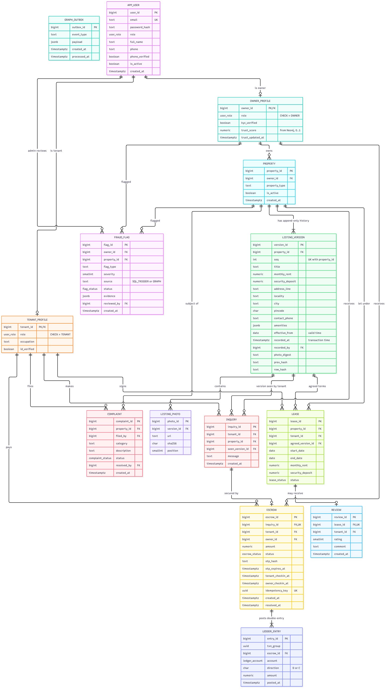

## 6. Relational schema and data dictionary
14 tables: `app_user, tenant_profile, owner_profile, property, listing_version, listing_photo, inquiry, escrow, ledger_entry, lease, review, complaint, fraud_flag, graph_outbox`. Normalised to 3NF; subtype tables (tenant/owner) are role-pinned with composite FKs so a tenant id can never be used where an owner is required. Complete column, constraint, index and trigger listing: [data-dictionary.md](data-dictionary.md). Source DDL: `db/01_listing.sql` + `db/02_workflow.sql`.

## 7. Choice of databases and justification
| Data | Store | Why |
|---|---|---|
| Users, listings, escrow, ledger, leases | PostgreSQL | ACID transactions, FKs, CHECK/EXCLUDE, triggers, stored procedures; money needs strict consistency |
| Listing history | PostgreSQL | append-only + hash chain + bitemporal columns are naturally relational |
| Owner/phone/address/photo relationships, verified-stay edges | Neo4j | Finding rings is a multi-hop shared-attribute traversal and PageRank is a graph algorithm; in SQL this needs recursive self-joins that are costly and unreadable |

Postgres stays the system of record. Neo4j is a derived projection fed by a **transactional outbox** (`graph_outbox`): the change event is written in the same transaction as the data, and a consumer (`scripts/graph-sync.ts`, `FOR UPDATE SKIP LOCKED`) applies idempotent `MERGE`s - at-least-once delivery without dual-write inconsistency.

## 8. Implementation
### 8.1 Architecture
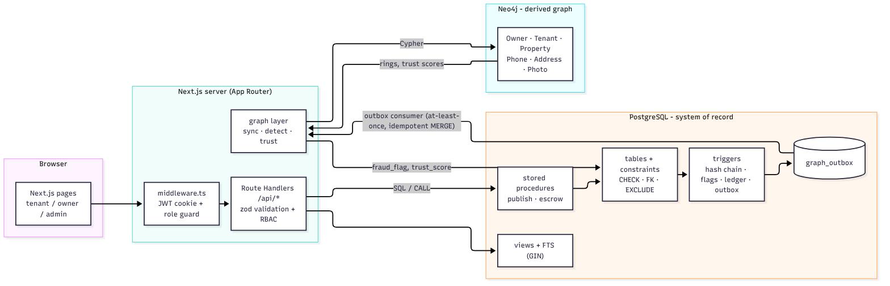
Browser -> Next.js middleware (page guard) -> route handlers wrapped by `route(roles, fn)` (JWT cookie, role check, zod validation, error mapping) -> PostgreSQL (procedures, triggers, outbox) -> graph layer -> Neo4j.

### 8.2 Advanced database features (requirement: at least 4; implemented: 10)
| # | Feature | Where |
|---|---|---|
| 1 | Transactions + stored procedures | `sp_publish_listing, sp_hold_escrow, sp_checkin, sp_release_escrow, sp_refund_escrow` |
| 2 | Triggers: hash chain, append-only, bitemporal | `fn_listing_chain`, append-only guard on `listing_version`, `fn_verify_listing_chain`, `fn_listing_as_of` |
| 3 | Trigger: bait-and-switch flag (rent +15% or deposit +50% within 14 days of an enquiry) | `fraud_flag` rows with source SQL |
| 4 | Trigger: complaint threshold (3 distinct complainants in 30 days) | |
| 5 | Deferred constraint trigger: double-entry ledger must balance | `ledger_entry` |
| 6 | Trigger: escrow state machine (HELD -> RELEASED / REFUNDED / DISPUTED only) | `escrow` |
| 7 | Views | `v_current_listing, v_owner_risk, v_escrow_summary` |
| 8 | Full-text search, GIN | `listing_version` tsvector |
| 9 | Partial/composite indexes, EXCLUDE (btree_gist) no overlapping active leases | `lease` |
| 10 | Graph traversal + PageRank | Neo4j via `src/lib/graph/` |

DDL demonstration (ALTER/DROP) is in the closing block of `db/01_listing.sql` + `db/02_workflow.sql`.

### 8.3 Graph algorithms
- **Ring detection:** Cypher finds owner pairs linked through a shared listing phone, account phone, photo hash or normalised address; application code clusters them with union-find. Edge weights: phone 3, account phone 3, photo 3, address 1; a pair is linked at weight >= 3. A photo reused by a later lister marks that lister as the likely thief.
- **Trust:** personalised PageRank (damping 0.85) over `VERIFIED_STAY` edges, teleporting only to ID-verified tenants. Fake tenants with no verified-tenant ancestry add no trust. Scores are written to `owner_profile`.
- Findings are saved into `fraud_flag` (source GRAPH); dismissed flags are not re-raised.

### 8.4 Application security
bcrypt, httpOnly SameSite JWT cookie (HS256, 8 h), role guards twice, login/sign-up rate limits, zod + DB constraints, parameterised queries, idempotent payment key, OTP stored only as a bcrypt hash and shown once, upload magic-byte check with content-addressed filenames, price lock (a lease uses the terms the tenant saw).

## 9. Important queries
SQL (live on Admin > SQL insights, see screenshot 16): average rent per locality (GROUP BY on a view); listings above locality average (correlated subquery); owners with open flags/complaints (multi-table JOIN + HAVING); every rent change with previous value (window `LAG`); escrow money by status; ledger balance per account.

Cypher (`db/neo4j_model.cypher`, generated from `src/lib/graph/cypher.ts`): owners sharing a phone, owners sharing a photo with the earliest lister, owners at a normalised address, stay edges for PageRank.

Bitemporal evidence: `SELECT * FROM fn_listing_as_of(<property>, <time>)` returns the version the database knew at that moment.

## 10. Screenshots
| | |
|---|---|
| 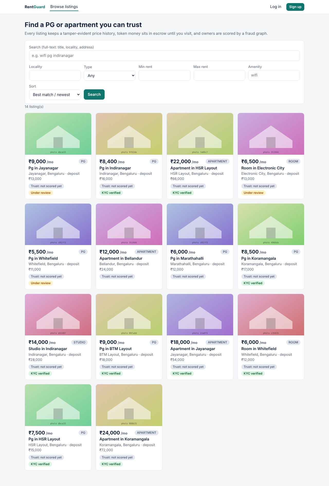 Home | 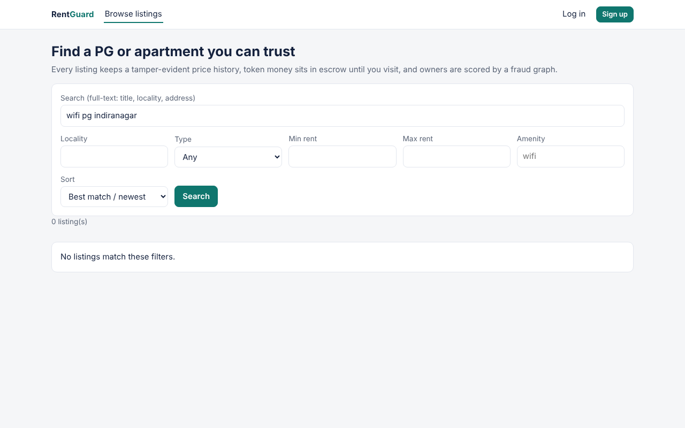 Full-text search |
| 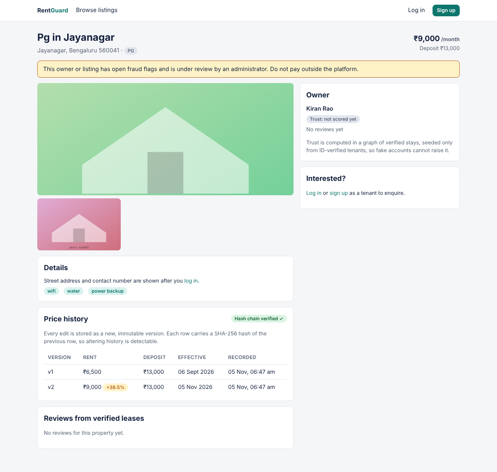 Hash-chained history | 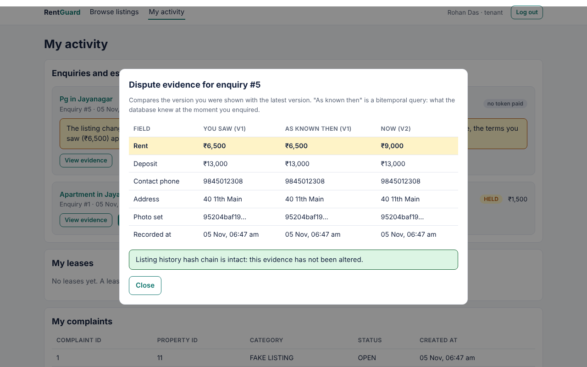 Dispute evidence |
| 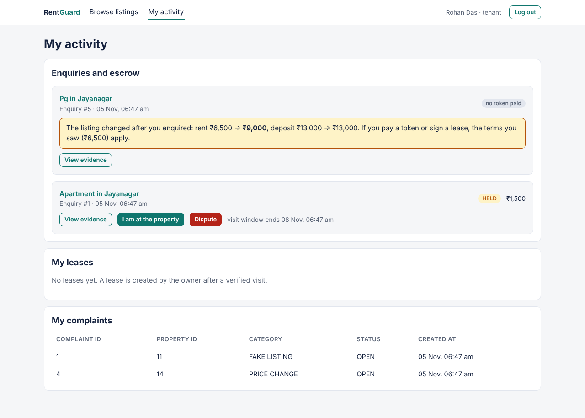 Tenant | 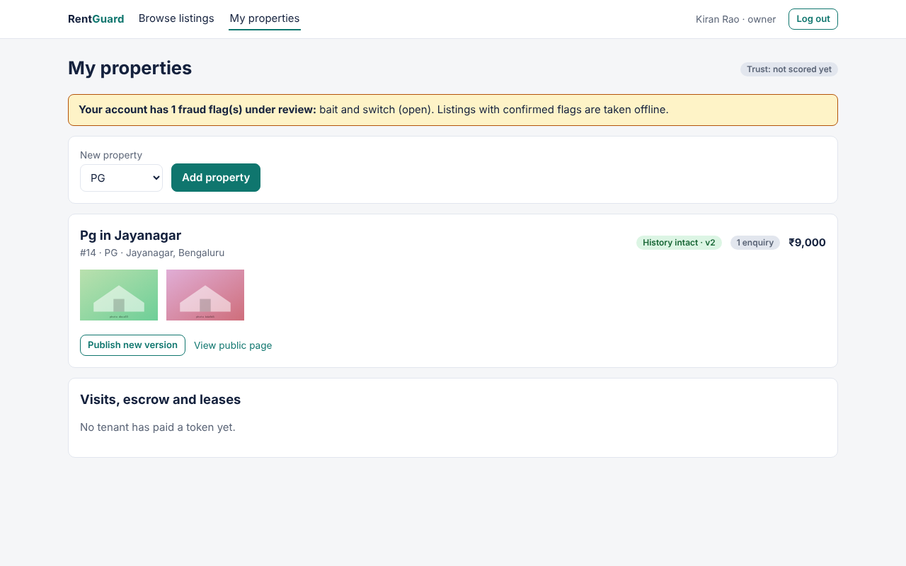 Owner |
| 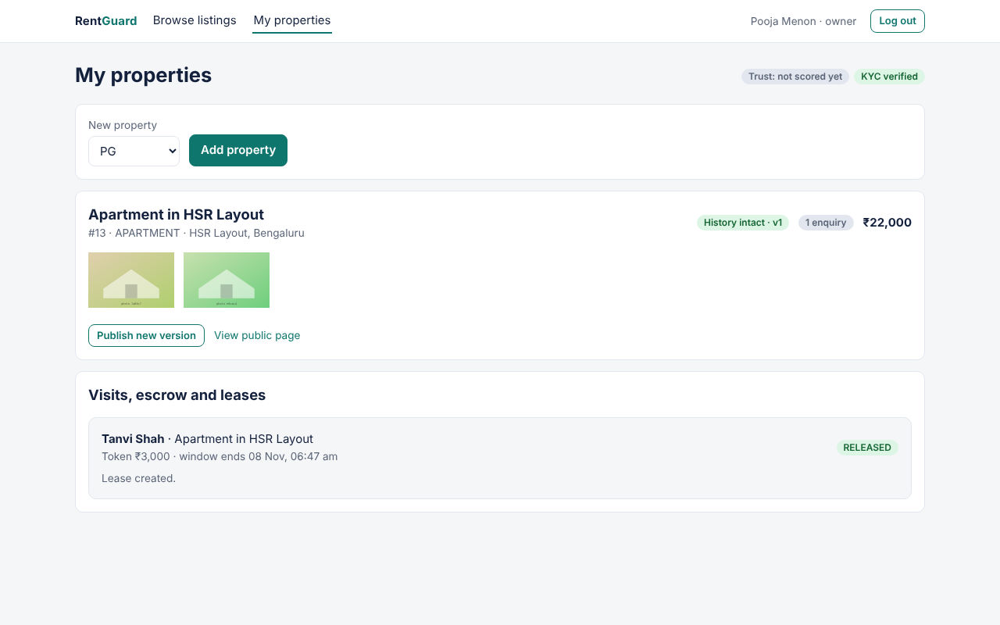 Escrow | 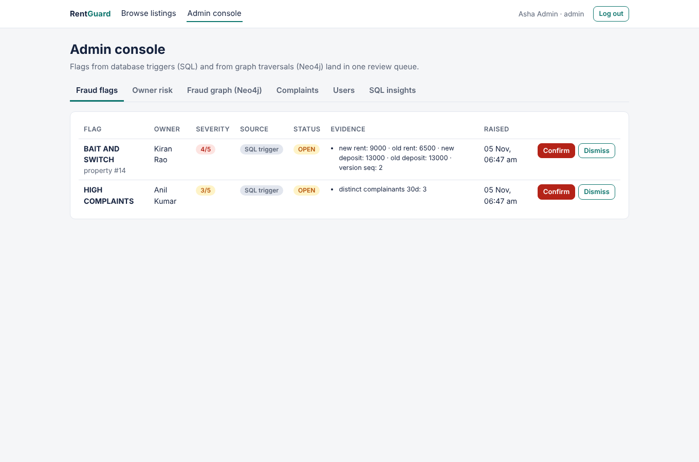 Fraud flags |
| 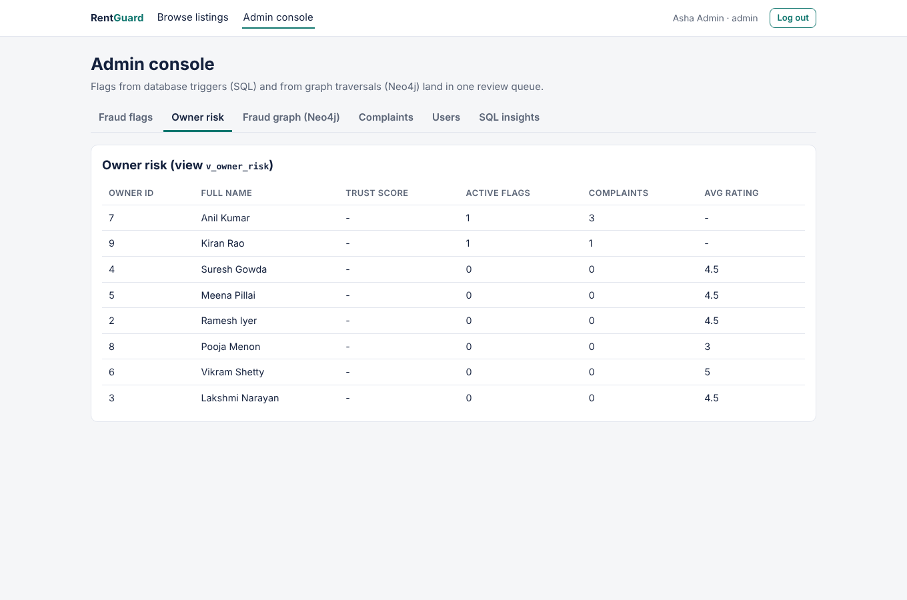 Owner risk view | 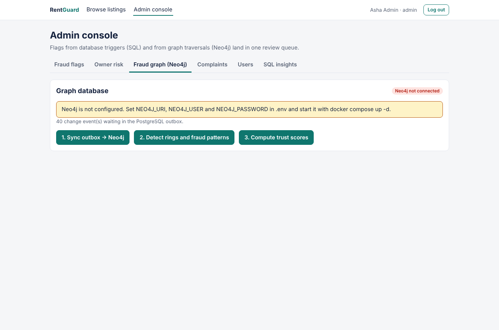 Graph tab (Neo4j offline here) |
| 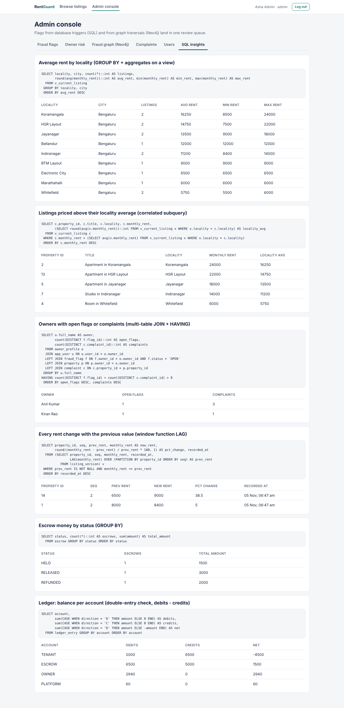 SQL insights | 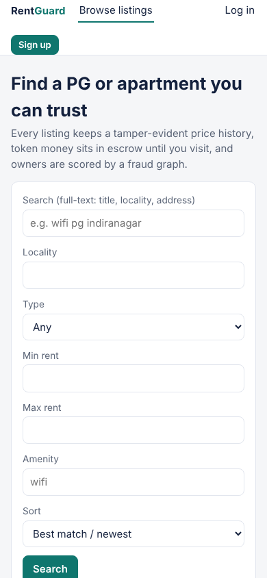 Mobile |

## 11. Testing results
- Unit + Cypher syntax: **32 / 32 pass** (`docs/test-unit.txt`) - hash chain, PageRank, clustering, address normalisation, Cypher parsed by the official Neo4j parser.
- End-to-end over HTTP: **23 / 23 pass** (`docs/test-e2e.txt`) - auth, role denial, validation errors, listing versioning, bait-and-switch flag, escrow lifecycle with OTP, refund, lease creation, review guard, complaint threshold, admin actions.
- `tsc` clean and `next build` succeeds; mobile page has no horizontal overflow.
- **Not tested:** live Neo4j. The graph layer was verified with a Postgres-backed emulator; re-run on the Docker Neo4j before the demo.

## 12. Conclusion
RentGuard shows why a hybrid design is justified: relational guarantees protect money and history, a graph exposes collusion patterns, and the database itself rejects invalid or tampered data.

## 13. Future work
Perceptual photo hashing or pgvector similarity for near-duplicate photos; admin resolution path for disputed escrow; real payment gateway and geofenced check-in; shared (Redis) rate limiter; scheduled graph jobs.
